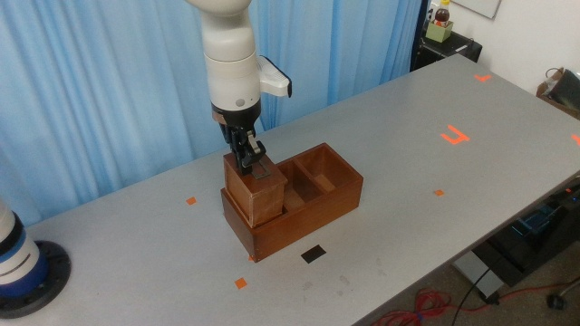
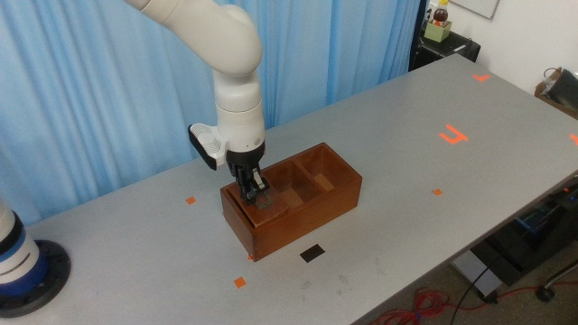
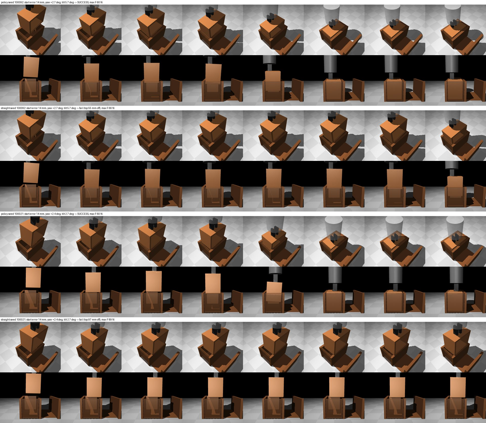
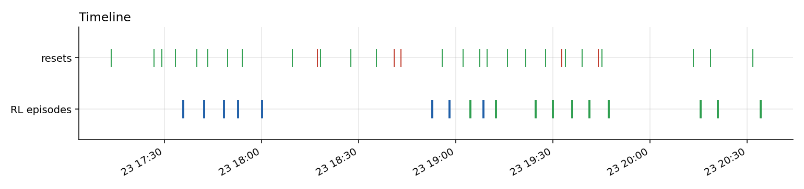
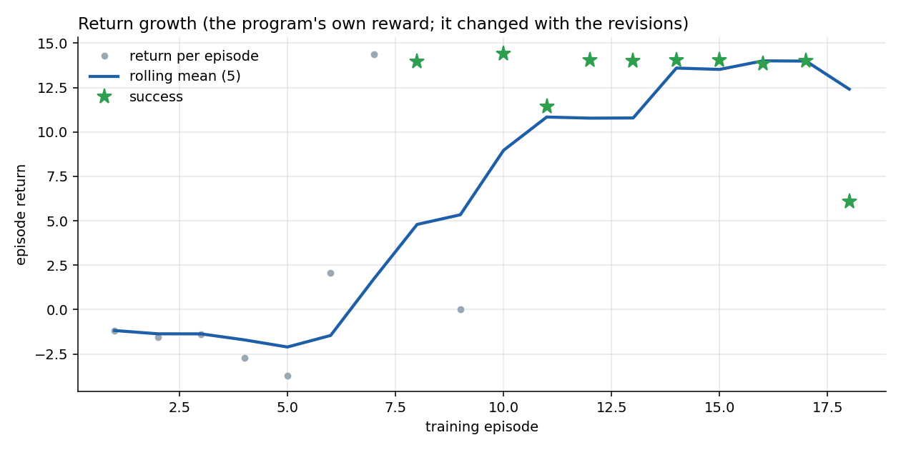
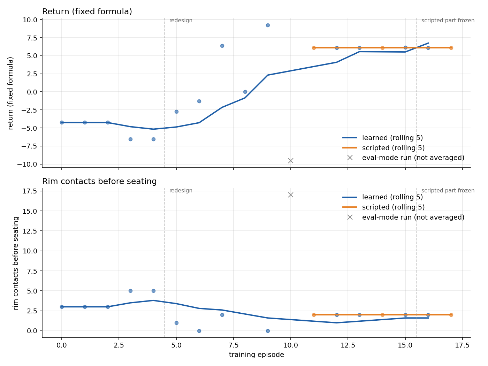
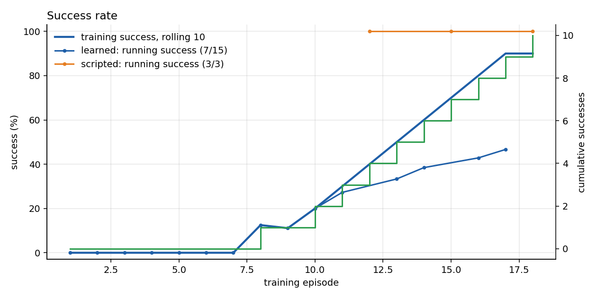
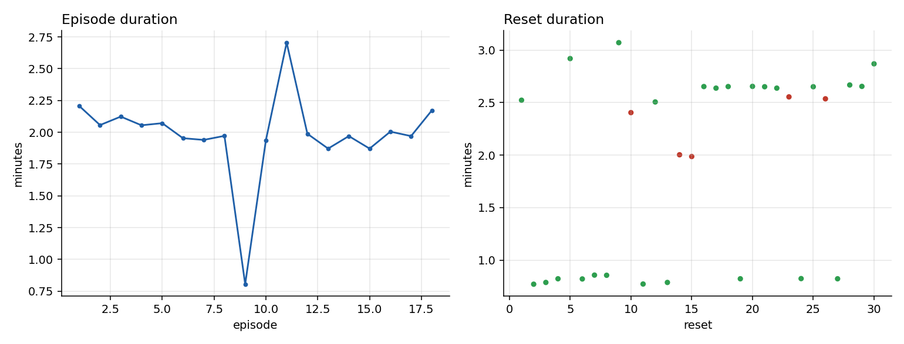
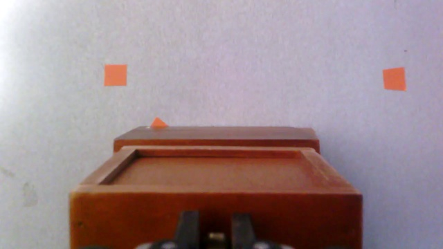
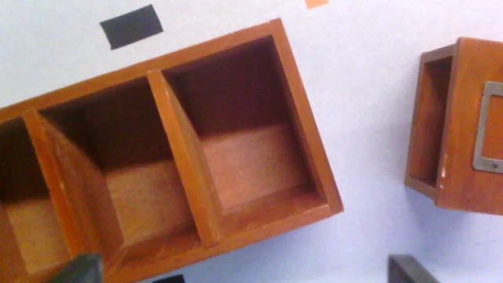

# Agents as RL engineers: real-world drawer insertion on a Kinova Gen3 run by coding agents

First draft, written from the records of run `20261123_1616_drawer` while the run is still going. Data up to training
episode 16 (2026-11-23, 20:21). Numbers that do not exist yet are marked **[TBD]**. The generated blocks (between
`<!-- BEGIN:... -->` and `<!-- END:... -->`) are rewritten by `python3 docs/report/make_tables.py --update --figures`.

## Numbers to update when the run ends

- [ ] Re-run `python3 docs/report/make_tables.py --update --figures` (all generated tables, the summary list and the
      figure copies in `docs/report/figures/`).
- [ ] Abstract: training episodes, counted successes, final evaluation k/10 with its interval, learned vs scripted
      numbers in the comparison window (episodes >= 17), sim-arm result k/5, total cost and robot time.
- [ ] Section 7.4: evaluation result and text (one round of 10 deterministic episodes after 50 training episodes).
- [ ] Section 7.5: learned vs scripted in the window: table, the test of the difference, and the sentence that says
      whether the learner helped.
- [ ] Section 7.6: sim-policy arm (episodes 31, 34, 37, 40, 43): outcome, forces, whether the force-direction cue held.
- [ ] Section 5.6: state when the learned arm first used the fixed-formula reward and first-descent exploration
      (commit `017e23a`, 20:28; first learned-arm episode after it: 18 if nothing else changes).
- [ ] Section 8: interventions after 20:28 from `OPERATOR_LOG.md`; final counts in Table 8.
- [ ] Section 7.8: final cost, agent and robot time; the sim worker's cost if it can be recovered.
- [ ] Figures: `scripts/rl_plots.py` marks the freeze at episode 16 and counts episodes 0-8 and 10 as "learned" in
      `success.png`; the text below uses r4 from episode 15 and the repaired learner from episode 17. Align the plot
      or the captions before the final version.
- [ ] Figure 1 (architecture) still to draw.
- [ ] Appendix C: final video assets.

## Abstract

We report a course-project experiment in which coding agents carried out the chores of real-world reinforcement
learning on a Kinova Gen3 arm. Two Claude agents, run headless by an orchestrator, wrote and repaired the reset
program, the episode program, the reward and an off-policy learner (AWAC), and reviewed every episode, while a fixed
robot library enforced safety and an independent verdict (side-camera geometry plus a vision-language judge) decided
success. The task: pick up a drawer standing on its back wall beside a wooden cabinet that lies on its back, and lower
it, pull up, into the compartment nearest the robot, with 1-2 mm of clearance per side. A previous attempt with the
cabinet standing upright had no success in 30 training episodes. In this run the first five episodes ended with the
drawer resting on the rim. After the agent rebuilt its program (opening measured before the grasp, a touch search on
the rim, a stored start offset), 11 of the next 12 episodes inserted the drawer and the 8 training episodes before the
time of writing were all independent successes, with no manual reset and one manual touch of the scene. A scripted
baseline arm (the same program with the learned residual switched off) did as well as the learned arm, so the gain so
far comes from the agent's program changes, not from learning. **[TBD: training episodes in total, final evaluation
k/10, learned vs scripted after the freeze, zero-shot sim-policy arm k/5, total cost.]** A simulation built by a
separate agent (MuJoCo with a Newton GPU twin, PPO) reached 74.8 % success against 21.0 % for a straight descent and
59.6 % for a force-guided script. Its main finding, that the sideways contact force points toward the opening, agreed
with all 25 real rim touches that preceded an entry (median cosine 0.86), with a bias caveat discussed in Section 6.6.

## 1 Introduction

Real-world reinforcement learning on a robot needs much more than a learning algorithm: someone has to reset the
scene after every episode, design observations, actions and rewards, tune the learner, notice when the learner or the
measurements go wrong, and keep the robot running. In most papers these chores are done by people, and the time they
take is not reported. This project asks how much of that work coding agents can do on a real arm, and what remains for
people.

The setup builds on our first experiment in this course project, where agents collected demonstrations for a
vision-language-action model (pi0.5) on the same arm. Here the agents own the whole RL loop. An orchestrator runs
reset, episode, independent verdict, learner update and agent reflection in a loop; a reset agent writes the program
that undoes the task; an RL agent writes the episode program, its reward and the learner. The reset is itself an
agent-written robot program, so the loop needs no human resets, which makes the setting close to reset-free real-world
RL: a person stays at the emergency stop but is not asked to act.

The task is a vertical insertion with small clearance: a drawer (top face 72 x 113 mm) has to go into a compartment
whose opening is 75.7 x 115 mm, back wall first, until its top is flush with the rim. The cabinet lies on its back on
the table, so gravity helps and no pushing against wood friction is needed; the difficulty is millimetre alignment
from cameras that are calibrated to a few millimetres.

What this report contributes:

1. A working system in which agents write, test and repair all robot programs of an RL experiment, with safety rules
   enforced in the robot library rather than in prompts, and with every agent turn, robot program and human action
   recorded (Section 3).
2. A real-world run: from five rim failures to consistent insertions within about 1.5 hours of RL operation, without
   manual resets (Section 7).
3. An honest attribution of the improvement. A scripted baseline arm and a fixed return formula separate program
   redesign from learning; so far the redesign explains the result (Sections 5.6, 7.3, 7.5).
4. A simulation of the lying-cabinet insertion built by a separate agent in two hours, with a PPO policy and baselines,
   and a first real-world check of its main prediction (Section 6).
5. A list of every human intervention and every failure, with causes (Section 8).

## 2 Prior attempt and lessons

The first drawer experiment (run `20261117_2026_drawer`, 2026-11-17 to 2026-11-21) used the same cabinet standing
upright, front toward the robot: the reset pulled the drawer out of the bottom slot and the RL agent pushed it back in
horizontally, with the pull only 4 cm above the table. It produced 30 training episodes and one evaluation round, all
failures (0/30, 0/5), and 110 resets of which 56 passed the layout check. The insertions jammed 1-3 cm before the end
with forces of 50-95 N (the drawer's static friction alone was 51-57 N); one snag at about 100 N moved the cabinet,
after which a force stop was added to the library (50 N, later 65 N). The cabinet's slot position, estimated from
side-camera depth blobs, was off by about 2 cm sideways, and a correction applied during the run had the wrong sign; a
standing-cabinet simulation policy drifted sideways on the real robot against a wedge the simulation did not model.
The run also lost hours to room lighting and to an evaluation round that restarted after every relaunch.

Lessons carried into this run:

- Locate small targets with the wrist camera looking straight down, not with side-camera blobs.
- Enforce rules in the system (force stop, keep-out boxes, an orientation check of every reset) instead of only
  asking agents in notes; notes alone did not stop repeated mistakes.
- Measure the scene geometry right before the run, and recalibrate the side camera when it moves.
- Choose a task geometry that does not depend on sliding wood under high force: the cabinet now lies on its back
  (user decision, 2026-11-23), so the drawer is lowered in with gravity.
- Keep a baseline that separates learning from program edits (new in this run, added after episode 8).

From the imitation-learning experiment we kept the recording format and the habit of checking data before blaming the
learner; its specific data rules (one wrist solution, no idle frames) do not apply here.

## 3 System

### 3.1 Overview

**[Figure 1 placeholder: architecture. Boxes: orchestrator (robot PC); reset agent and RL agent (Claude Code
sessions on the GPU workstation, each with a git workspace); robot library (RobotSession: model check, keep-out,
force stop, watchdog); side RGB-D camera and wrist camera; verdict (geometric check + VLM judge); learner (robot PC
GPU); records (events, episodes, transcripts, usage); operator (e-stop, notes, RESTART). Arrows: reset -> episode ->
verdict -> learner -> reflection.]**

| Part | What it does | Who wrote it |
|---|---|---|
| Orchestrator (`rlpj/orchestrator/loop.py`) | runs the phases check, develop reset, develop RL program, RL training; gates every robot run; computes verdicts; logs everything | us (before the run) |
| Reset agent | writes `programs/reset.py --targets t.json`: take the drawer out of any state and stand it at the target | agent |
| RL agent | writes `programs/execute.py` (one episode), `programs/learner.py`, its reward, observation and action spaces | agent |
| Robot library (`rlpj/robot/`) | `RobotSession`: the only API that moves the arm; model checks, keep-out, force stop, watchdog | us |
| Verdict (`rlpj/success/`) | geometric check `drawer_lying` on the side-camera cloud and a VLM judge | us |
| Simulation (`sim/drawer_insert/`, lying part) | MuJoCo/Newton model of the descent, PPO policy, baselines | a separate agent ("sim worker"), started by the operator |
| Operator | student at the e-stop plus a supervising coding assistant that kept the log, wrote notes and made configuration changes | people (and the assistant) |

Hardware: a Kinova Gen3 arm (6 joints) with a parallel-jaw gripper and a wrist colour camera, a fixed side RGB-D
camera (Intel RealSense), a robot PC with an RTX 4090 that runs the orchestrator, the robot programs and the learner,
and a GPU workstation with an RTX 5090 that runs the agents and the VLM judge. Agents cannot reach the arm; their
programs run on the robot PC only when the orchestrator starts them.

### 3.2 Agents

Each agent is a headless Claude Code session (model Claude Opus 5.5, effort "high") with its own git workspace. Every
turn ends with one structured action: `run` (a command, with a flag saying whether it moves the robot), `done`,
`need_operator` or `give_up`. On `run`, the orchestrator syncs the workspace to the robot PC, runs the command as a
recorded attempt, syncs results back and resumes the session with a digest (exit code, `summary.json`, log tail,
image list the agent may open). The workspace settings deny writes outside the workspace and any command that
contains `RLPJ_MOTION`, `ssh`, `scp` or `rsync`. In autonomous mode (`--autonomous`) a `need_operator` request gets a
standing reply ("do it with the robot or skip it"), so no person is asked to act.

The RL loop adds two kinds of turns without robot access: a reflection turn after every episode (up to 4 agent turns,
running while the next reset executes) and a tuning turn every 5 training episodes with the learning curve and the
recent failures; in tuning turns the agent may also run real test attempts. Operator notes (`runs/<run>/notes/<role>.md`)
are delivered once at the start of the agent's next turn and logged.

### 3.3 The RL loop

`rl_train` repeats until `rl.max_episodes` or an evaluation that reaches the target rate:

1. Sample a reset target (drawer position in a 2 x 2 cm box beside the cabinet) and run the reset program. The
   orchestrator then checks the layout with the side camera (the drawer blob within 2 cm of the target) and asks the
   VLM whether the drawer stands upright, pull up, out of the cabinet (`reset_orientation`). A failed reset is retried;
   after repeated failures the reset agent gets a repair turn (up to 10 repairs per failing reset).
2. Run the episode program (recorded, mode `rl`, environment `RLPJ_RL_MODE=train`, `RLPJ_EPISODE=<index>`).
3. Compute the verdict and write it to the agent's data folder (`rl/verdicts/<episode>.json`) so the learner can use
   it as the terminal reward.
4. Run `programs/learner.py` on the robot PC's GPU (time limit 300 s; here 2-10 s per update).
5. Start the agent's reflection on this episode in the background while the next reset runs.

Every `eval_every` training episodes, a fixed evaluation runs `eval_episodes` episodes with `RLPJ_RL_MODE=eval`
(deterministic policy). In this run: one evaluation of 10 episodes after 50 training episodes (changed at 20:19 by user
decision from 5 episodes every 30). A restart (`echo why > runs/<run>/RESTART`) makes the orchestrator exit at the next
safe point; a launcher loop relaunches it, so configuration changes take effect without losing state.

### 3.4 Safety layer

All motion goes through `RobotSession` (`rlpj/robot/session.py`), which the agents use but cannot change:

- Every segment is checked in a kinematic model before it is sent: joint limits, speed, table clearance, the base
  column, reach, and the task's keep-out boxes. For this task the boxes cover the cabinet body up to 1.5 cm below the
  rim and its walls and dividers up to 0.5 cm above the rim (4 mm margin), with the compartment openings free. A motion
  that would put any gripper point inside a box is refused.
- Tracking: the arm is streamed joint speeds and the segment aborts at more than 1 deg or 10 mm deviation.
- Force stop: a segment stops when the estimated tool force exceeds the limit. The task cap is 65 N; programs may only
  lower it. The RL program used 20 N for the grasp approach and 25 N for every insertion step.
- A watchdog process stops and homes the arm if the program dies or stops heartbeating; on an abort the program
  returns home along a checked path.
- Speeds: 20 deg/s and 0.10 m/s normally, 5 deg/s and 0.02 m/s for slow segments.
- Motion needs `RLPJ_MOTION=1`, which only the orchestrator sets for a run it started, after printing the command and a
  countdown. Without it, every program is a dry run that still plans, checks and writes replay videos.

Outside the library, a cabinet guard script watched the cabinet position in the reset records and could pause the
run. It turned out to be nearly blind in this run (Section 8.3); cabinet motion was in practice checked by the
success check and by the RL program's own image comparison.

### 3.5 Verdicts

In RL mode the episode program's own claim is logged but ignored. Success needs both independent checks to say yes;
one yes is `unsure`, none is `fail` (`rlpj/success/verdict.py`).

- Geometric check `drawer_lying` (`rlpj/success/checks.py`): from a side-camera cloud taken with the arm at home, the
  points inside the target compartment's opening (shrunk by 1 cm per side) must be at rim height within 12 mm
  (flush share at least 0.6), no drawer-sized blob may remain on the table, and the cabinet outline may not have moved
  more than 2 cm. Before 18:57 the cabinet comparison used the blob centroid, which moves 3-5 cm when a compartment
  is filled; since then it uses the outline centre (2nd-98th percentile midpoints along and across the cabinet axis).
  On a drawer inserted by hand before the run, the check read flush share 1.0.
- VLM judge (`rlpj/success/vlm_judge.py`): Claude on the GPU workstation reads the before and after images of both
  cameras with the task's success text and returns success, confidence and a reason. Votes below confidence 0.5 count
  as no vote. Cost about USD 0.08 per call.

### 3.6 Recording

Each episode directory holds the side and wrist videos (15 fps), `steps.npz` (joints, commanded joints, tool pose,
gripper, phase per step), phases, the program's `summary.json`, before and after images and the log. Every robot
program, including the agents' tests, also writes a dashboard video with the program log. The orchestrator appends to
`events.jsonl` (phases, agent actions, attempts, resets, episodes, notes, restarts) and `usage.jsonl` (cost and tokens of
every agent turn and VLM call), copies the full agent transcripts after every turn, and writes `rl_curve.jsonl` (one row
per training episode). Plots are redrawn every 5 minutes (`scripts/rl_plots.py`). Human actions and mid-run system
changes go into `OPERATOR_LOG.md`, kept by hand. Agent code is in the workspaces' git histories.

## 4 Task setup

### 4.1 Scene and geometry

The cabinet (outer 275 x 139 mm, rim 95 mm above the table, walls 12 mm) lies on its back about 0.53 m in front of the
robot base, its long axis turned about 20 deg; its three compartments open to the top. The target is the compartment
nearest the robot. Geometry used by the system (base frame, metres, from `config/tasks/drawer_lying.yaml` and the RL
agent's measurements):

| Quantity | Value | Source |
|---|---|---|
| Compartment opening | 75.7 x 115 mm | side cloud + wrist look-down before the run |
| Drawer top face | 72.3 x 113 mm (wrist), 73 x 110 mm (side cloud) | RL agent, sim worker |
| Clearance | about 3.4 mm and 2 mm in total, 1-2 mm per side | difference of the above |
| Drawer length (back wall to front) | about 91 mm | reset survey cloud |
| Compartment floor | about 5 mm above the table (the yaml's 13 mm is too high) | inferred: inserted top 96.5-97 mm minus length |
| Pull | flat label frame (about 33 x 59 mm) with a short metal tab (about 12 x 12 mm), about 2 cm off the drawer's centre line | wrist images |
| Opening centre and axis | yaml: (0.4469, -0.011), 21.2 deg; RL agent's wrist measurement: (0.4519, 0.0029), 18.3 deg | the two differ by 1.5 cm and 3 deg |
| Drawer start | standing on its back wall, pull up, at x 0.26-0.28, y -0.03..-0.01 (0.28-0.30, -0.03..-0.01 before 19:45) | reset targets |

The reset target was chosen at least 14 cm from every table edge and about 5 cm clear of the cabinet. The reset agent
varied the drawer's yaw, mostly between -25 and -30 deg because of its own 10 cm edge rule.

**Figure 2.** Left: episode 0 ends with the drawer resting on the rim (`figures/jam_ep0_side.jpg`). Right: the first
insertion, test attempt 30 at 18:37 (`figures/inserted_attempt30_side.jpg`).

 

### 4.2 Measurement

Before the run, a recorded robot program (`scripts/measure_lying_cabinet.py`, run through `scripts/run_measure_lying.py`)
pulled the arm out of the side camera's view, saved a side image and point cloud, and took a wrist look-down from
about 30 cm above the rim. The operator side derived the cabinet geometry, the keep-out boxes, the reset target and the
success check from these (commit `badc6fb`). The RL agent re-measured the opening with its own wrist look-downs and
aligned to that measurement; the success check still uses the yaml's centre with a window shrunk by 1 cm per side, so
the 1.5 cm difference reduces the check's margin but did not cause a wrong verdict in this run (Section 7.2).

### 4.3 Side-camera calibration

The side camera had been moved before the run (131 mm and 10.3 deg from its last calibration), so it was recalibrated
by an automated program (`scripts/auto_side_calib.py`, which runs `scripts/side_calib_capture.py` through the
orchestrator's attempt runner and then `scripts/side_calib_solve.py`). An A4 ChArUco board lies on the table; the arm
finds it with the wrist camera from an overview pose and visits 12 model-checked viewing poses, saving a wrist image, a
side image and the tool pose at each. Per pose, T_base_side = T_base_tool T_tool_cam T_wristcam_board
T_side_board^-1 (the wrist camera's hand-eye calibration from earlier work); poses are averaged and outliers (more than
3 times the median deviation) dropped. On 2026-11-23 15:53 it took 11 minutes, used 11 of 12 views and had a spread of
9.7 mm and 0.66 deg (5.4 mm in an earlier run on 2026-11-20). The first three overview poses were refused by the
model check and the fourth, a straight tool line, passed. No person touched the arm or the board during calibration.

## 5 Method

All code in this section was written by the agents; file names refer to their workspaces
(`runs/20261123_1616_drawer/agents/<role>/programs/`).

### 5.1 Reset program

`reset.py` (646 lines, reset agent) handles the drawer in a compartment, standing on the table, held by the gripper,
or the arm stopped low. It scans with the side camera from home, finds the pull with a wrist look-down, pinches it
across its width under a 20 N approach limit, lifts straight up (2.5 cm first, then to 13 cm, re-closing the gripper
after each stage to detect a slip), carries the drawer to the target, lowers it under a 20 N limit until the back wall
is on the table, checks the outline is at least 10 cm inside every table edge before letting go, releases, goes home,
and measures the result with the same side-camera blobs the orchestrator uses (up to 6 frames), re-picking at most
twice. A drawer that already stands at the target is left in place (about 50 s instead of about 160 s).

### 5.2 Episode program

`execute.py` (about 630 lines, RL agent) does one episode:

1. **Look at the opening before the grasp**: wrist look-down from 0.30 m above the table at the target compartment
   (aim shifted 28 mm so the far long side is in the image); the rim is fitted, else a stored measurement is used.
2. **Find the drawer and the pull**: side depth finds the drawer in its own window (the drawer and cabinet blobs can
   merge); a wrist look-down measures the top face and the tab (with a retry on a smoothed or fresh frame).
3. **Grasp**: pinch the tab with the jaws along the drawer's long axis (20 N approach limit), at a fixed top height of
   91.2 mm unless the measurement is more than 8 mm away; check the gripper reading (60-97 = held).
4. **Lift and carry**: lift, turn the drawer so its long side lies along the opening and the tab points to the near end
   wall, carry, and hold the drawer's bottom 8 mm above the rim at the measured opening plus a start offset.
5. **Insert** (Section 5.3), **release**, rise, go home.
6. **Verify** with its own copy of the flushness check and an image-shift test for cabinet motion (logged, not
   trusted by the orchestrator).

### 5.3 Insertion: learned residual and touch search

The insertion is a loop of small Cartesian steps in the opening frame (a along the cabinet's long axis, pointing away
from the robot; b across; yaw), each a model-checked segment with a 25 N force stop.

| | Definition |
|---|---|
| Action (4, tanh-bounded) | residual corrections along a and b (1 mm per unit), yaw (0.5 deg per unit), and the descent step scale: step = 7 mm x (1 + 0.5 a4), i.e. 3.5-10.5 mm. Accumulated corrections bounded to 18 mm and 4 deg around the start. Lateral residuals are zeroed once the drawer is 4 mm inside the opening. |
| Observation (13) | phase (align or descend), inserted fraction, applied corrections (3), force change in the opening frame (3), last peak force, step fraction, pinch point on the drawer (2), contacts so far |
| Prior | zero residual: straight down from the start pose |
| Step outcome | ok, force stop (contact), or refused by the model check |

The first two steps align at the hover height; then the drawer descends. On a force stop the program records the
contact height and the sideways force, lifts 4 mm, and moves to the next point of a **touch search**
(`programs/touch.py`): line searches along a (+3, +6, +9, +12, -3, -6, -9 mm), then b (+-2 to +-8 mm), then yaw
(+-1.5, +-3 deg), each from the lowest contact so far and dropping a direction once its contact is higher; then a
4 mm grid spiral over +-15 mm; at most 36 touches. A lower contact means the drawer is closer to dropping in, so the
search follows the contact height. The policy's residual is added to each search point. The drawer counts as seated
when it reaches 5 mm above the table, or when it is within 12 mm of the floor and the step either stopped on force or
peaked above 12 N.

The **start offset** (the first descent point relative to the measured opening) changed with the program revisions:
from the plan (episodes 0-4), to (+3, -3) mm taken from the lowest contacts of a probe grid (attempt 28), to a running
estimate of past entry points, a median, the densest cluster, the centre of first-descent entries only, and finally a
constant (about +2.9, -3.1 mm) from 20:08 on (Table 5.1).

### 5.4 Learner

`learner.py` (318 lines) implements AWAC (Nair et al., 2020) with twin critics: actor and critics are MLPs with two
hidden layers of 128 units (LayerNorm in the critics), discount 0.95, target update 0.005, learning rate 3e-4, batch
256, advantage temperature 0.3 with weights clipped at 20, and a pull toward the zero-residual prior with weight
exp(-episodes/10). It trains on all stored transitions after every episode (40 updates per new transition, 200-3000
updates, at most 200 s) and exports the actor as numpy weights for the episode program. Exploration in training
episodes: the actor's Gaussian (std clipped to at most 0.5 in pre-tanh units), extra noise (std 0.35) at search
points, and from commit `017e23a` extra noise (std 0.5) on the first descent of learned-arm episodes. Only data of the
current action meaning ("prior version 2", from 18:05) is used: at episode 16, 335 transitions from 16 runs (10
training episodes with transitions, episode 10 stored under a test name, and 5 real test runs of the agent).

Up to the tuning turn after 15 episodes the learner also tuned an entropy temperature and used it in the critic
target. With almost all logged actions exactly zero (scripted arm, zeroed lateral actions inside the opening) the
policy's spread collapsed, the temperature grew from 0.15 to 1.7 and mean Q fell to -92 while the real returns-to-go
were between -2.8 and 12.2. The agent found this at 20:10, removed the entropy term from the AWAC target, clamped
targets to [-20, 20], raised the minimum policy std to 0.1 and restarted actor and critic on all data. Because of a
lost commit (Section 8.3) the fix first ran after episode 16 (Q 3.9, critic loss 0.58), so the first episode acting
with the repaired learner is 17.

### 5.5 Rewards

**The agent's reward** (episodes 0-16): per step -0.02, plus 30 per metre of descent on steps without a force stop,
minus 0.05 per 5 N of peak force above 15 N, -0.15 per force stop and -1 per refused step; at the end +10 for a success
plus flushness terms (+2 x flush share, -2 x share above, -1 x share too deep, -1 if a drawer remains on the table).
The learner replaces the terminal bonus by one from the orchestrator's verdict: +10 for success, 0 for failure (-5 only
when the verdict says the drawer is upside down), and +10 for an `unsure` verdict with a VLM yes and the drawer at the
floor. A success scores about 14 whatever the number of touches, so this reward saturated from episode 6 on and could
not show progress (Figure 6).

**The fixed-formula return** (used for the report's curves, `scripts/rl_plots.py` `fixed_return`, the same for every
episode and arm): +10 if the verdict is success, -1 per force stop during the insertion, -0.1 per N of the last step's
peak force above 15 N, -0.05 per insertion step. Two details matter when reading it: the force-stop count includes the
final stop on the compartment floor, and the peak is that of the last step, recorded as 25 when a force stop fired. A
success with one rim touch and a floor stop scores 6.1; the best episodes so far (no touch, seated below the stop)
scored 9.25. Episodes 5 and 6 were real insertions but count as failures here because their verdicts were `unsure`.
From 20:28 the agent uses this return as its reward (spread over the steps, stored episodes relabelled; commit
`017e23a`), at the operator's request.

### 5.6 Arms and revisions

| Arm | Episodes | Policy |
|---|---|---|
| pre-arm | 0-8 | the learned actor with exploration; arms not defined yet (its residuals were near zero) |
| scripted baseline | every training episode with index % 3 == 2, from 11 (11, 14, 17, ...) | same program, residual zero, no exploration |
| learned | all other training episodes from 9 | AWAC actor with exploration |
| learned (eval mode) | 10 | deterministic actor; ran in eval mode by a labelling bug (Section 8.3) |
| sim (zero-shot) | 31, 34, 37, 40, 43 (planned) | the simulation's PPO policy unchanged (with the same grasp, alignment and carry), its own search instead of the touch search, force stop 25-40 N |
| evaluation | 10 episodes after 50 training episodes | deterministic learned actor |

The scripted arm was added at 19:10 by user decision; episode 8 satisfied the index rule but ran before the change.
The scripted part (everything except the residual) was revised four times and then frozen:

**Table 5.1** Program revisions of the RL agent (workspace git history).

| Commit (time) | Change | First episode |
|---|---|---|
| `2f0398e`..`631db0e` (17:27-17:57) | first episode program; levelling and tilt measurement (then off); wider alignment search; hover correction from the wrist image | 0-4 |
| `1cbb663`, `c668ca8`, `337a80b` (18:05-18:24) | measured drawer-vs-opening alignment at the hover; tilt sweep; 2-D probe grid (real tests 24, 26, 28) | tests only |
| `f4e80c5` (18:33) | opening measured before the grasp (look aim fixed), hover correction logged only, touch search, start offset (+3, -3) mm, floor 5 mm | test 30, episode 5 |
| `87de17e`, `dd1c01b` (18:55-18:59) | own cabinet check by image shift and outline centre; verdict relabel; entry-offset estimate; no lateral residual inside | 6, 7 |
| `5b26018` (19:06) | start offset = median of past entries | 8 |
| `a0c9a76` r1 (19:10) | scripted arm; blurred-frame retry for the pull | 9, 10 |
| `0b4e277` r2 (19:27) | run identity from the orchestrator; fixed pinch height | 11 |
| `35b9f57` r3 (19:30) | start offset = densest cluster of past entries | 12-14 |
| `48fa784` r4 (19:48), `317d578` (20:08) | only first-descent entries update the start offset; then the offset frozen as a constant for all arms | 15 |
| `ee3328c` (20:16) | learner: critic divergence fixed (Section 5.4) | 17 (actor) |
| `00d1a89` (20:25) | sim arm for episodes 31-43 | 31 |
| `017e23a` (20:28) | reward = fixed-formula return; extra first-descent exploration in the learned arm | 17 (learner), 18 (learned arm) |

The comparison window for learned vs scripted is therefore training episodes 17 and later: the scripted part is r4
with a constant start offset (since 15), the learner is the repaired one (actor first used in 17) and both arms use the
same reward. The first learned-arm episode in the window is 18. **[TBD: confirm no later change to the scripted part;
the agent may change it only to fix an observed failure, named in its notes.]**

## 6 Simulation

### 6.1 Who built it

The operator started a separate agent (the "sim worker", a Claude Code session) at 16:33 to build a simulation of the
lying-cabinet descent while the RL run went on. It finished at 18:32 (commits `7690f86`, `e374011`) and trained on the
robot PC's RTX 4090. The RL agent was told about it at 18:30 but did not use it before the extension at 20:19, when the
zero-shot sim arm was added (Section 5.6). The description below follows `sim/drawer_insert/README.md`, section
"Lying cabinet".

### 6.2 Model

MuJoCo 3.17 (1 ms step, implicit-fast integrator, elliptic friction cones) models only the descent: the hand is four
position-servoed joints (x, y, z, yaw) and carries the drawer through a compliant pinch at the pull, modelled as spring
plus Coulomb-slip joints for the slide along z, tilt about both horizontal tool axes and yaw. The compartment has a
floor, four walls with rounded inner rim edges and, beyond the divider, the middle compartment. Randomized per
episode: opening size (74.5-77.0 x 113.5-116.5 mm, clearance 2-6 mm per axis), rim height, drawer length (88-94 mm),
edge rounding, mass (0.12-0.30 kg), friction (0.2-0.6), the opening pose error (+-10 mm, +-3 deg), in-hand offset,
yaw and tilt (up to 8 deg), the wrist estimate errors, grasp compliance, arm stiffness, force-estimate bias, drift and
noise (sd 1-3 N at 40 Hz), the force-stop level (40-65 N) and the start height (5-25 mm above the rim). A Newton GPU
twin (`newton_lying.py`) runs the same model for training.

Observation: commanded tool pose in the believed opening frame, wrist estimates of the in-hand offset, yaw and tilt,
force minus its value at the start of the descent, last peak force, stop flag, previous action and step index.
Action per decision (0.18-0.22 s, 60 decisions): dx, dy in +-4 mm, dyaw in +-2 deg, dz in -8..+4 mm, with bounds of
+-15 mm, +-8 deg around the start. Success: all four top corners within 10 mm of the true rim and the true contact
force below 40 N at the end. Reward per step: depth gain, lateral progress toward the true opening centre (privileged
shaping), a force penalty above 40 N and a success bonus. Episodes start from a reset-to-states bank (straight-descent
and drift pre-rolls that leave the drawer on the rim, cocked or part-way in, plus fresh starts), as in SGS-style
curricula.

### 6.3 Training

PPO (2 x 256 tanh MLP, Gaussian policy, discount 0.99, GAE 0.95, clip 0.2, 4 epochs, minibatch 4096, learning rate
3e-4; the actor's last layer initialized to "descend 5 mm per step") with 4096 parallel worlds in Newton. Four runs
chained by fine-tuning (ly_n1 to ly_n4: 3.7, 4.8, 13.3 and 22.2 M samples, 8, 9, 30 and 47 minutes); the shipped policy
is ly_n4 iteration 100 (76.5 % on 4096 deterministic carry starts in Newton). A first run with a stronger force penalty
learned to hover above the rim and was stopped.

### 6.4 Results

<!-- BEGIN:sim -->
<!-- generated by docs/report/make_tables.py from runs/20261123_1616_drawer at 2026-11-23 20:39 -->

500 episodes per cell (MuJoCo CPU reference, seeds 100000-100499, same episodes for every controller).

| Start / variant | Straight descent | Spiral search | Force-guided script | PPO policy |
|---|---|---|---|---|
| carry (full ranges) | 21.0 % | 14.0 % | 59.6 % | 74.8 % |
| carry, released when seated | 15.6 % | 9.4 % | 49.2 % | 70.2 % |
| small (opening +-3 mm / +-1 deg) | 46.2 % | 32.8 % | 78.4 % | 94.8 % |
| big_open (opening +-15 mm / +-5 deg) | 9.2 % | 5.8 % | 43.2 % | 52.6 % |
| after 8 straight-descent steps | 21.0 % | 14.4 % | 59.4 % | 76.2 % |
| after 10 drift steps | 19.2 % | 15.0 % | 56.8 % | 73.6 % |

Stress tests (carry start):

| Start / variant | Straight descent | Spiral search | Force-guided script | PPO policy |
|---|---|---|---|---|
| force noise sd 3-5 N, bias +-6 N | 18.4 % | 10.8 % | 53.6 % | 56.4 % |
| clearance 1-2 mm | 5.4 % | 3.8 % | 30.8 % | 48.0 % |
| in-hand estimate sd 5-10 mm, 3-6 deg | 8.2 % | 5.2 % | 39.8 % | 50.6 % |
| tilt estimate passed as zero | 21.6 % | 12.0 % | 61.6 % | 72.2 % |
| friction 0.6-0.9 | 17.8 % | 10.6 % | 66.4 % | 71.4 % |
| loose grasp | 20.0 % | 12.8 % | 57.6 % | 78.0 % |
| arm 5e3-2e4 N/m | 32.4 % | 20.2 % | 50.8 % | 69.6 % |
| decision period 0.5-1.0 s | 21.4 % | 16.0 % | 59.8 % | 74.2 % |
| force stop 25-40 N | 16.8 % | 12.6 % | 65.4 % | 72.8 % |

Policy on carry starts: median true peak force 74 N, 6.9 force stops per episode, median 23 decisions to the first success state.

Newton vs MuJoCo (straight descent, 1024 carry episodes): success 11.7 % vs 11.7 %, per-episode agreement 97.5 %, median depth difference 0.07 mm.
<!-- END:sim -->

The controllers are a straight descent from the believed pose (back up 2 mm after a stop), a spiral search (2.5 mm
pitch, +-1 deg yaw after each jam), a force-guided script (step 2 mm per N along the measured lateral force while
pressing; written by the sim worker after it saw what the policy learned, tuned on 300 episodes) and the PPO policy.
In contact, the policy's lateral step points along the measured lateral force (mean cosine 0.95 over 2093 decisions):
it learned a force-guided search, which is why the hand-written force-guided script is the strongest baseline. The
policy's median true peak force (74 N) is high because the stop overshoots between 40 Hz samples; with a 25-40 N stop
its median peak is 56 N. On the real robot the RL program stops at 25 N.

**Figure 4.** Policy (rows 1 and 3) and straight descent (rows 2 and 4) on the same two episodes with 14 mm start
errors: the policy lands on the rim, steps toward the lateral force, drops in and seats; the straight descent stays on
the rim. Decisions 0, 5, 10, 15, 20, 30, 45, 59.



### 6.5 Engine agreement

Newton (GPU, training) and MuJoCo (CPU, evaluation) were compared with the straight descent on the same 1024 parameter
sets: equal success (11.7 %), per-episode agreement 97.5 %, median depth difference 0.07 mm, median peak force 79.5 vs
80.5 N. Throughput was about 11k decisions per second at 2048 worlds on the RTX 4090, against about 350 per CPU
process.

### 6.6 A first real-world check of the force cue

The simulation predicts that when the drawer rests on a rim edge, the sideways force on the tool points toward the
opening. The RL program logs the sideways force in the opening frame at every rim touch (`insert.contact_map`), and for
episodes that went in we know the entry point. The table compares, for each rim touch, the force direction with the
direction from the touch point to the entry point.

<!-- BEGIN:force -->
<!-- generated by docs/report/make_tables.py from runs/20261123_1616_drawer at 2026-11-23 20:39 -->

| Ep | Rim touches | Min cos | Median cos | Mean f_a (N) | Mean f_b (N) |
|---|---|---|---|---|---|
| 7 | 2 | 0.97 | 0.98 | +7.1 | +0.9 |
| 10 | 17 | 0.43 | 0.73 | +4.9 | -2.9 |
| 11 | 1 | 0.97 | 0.97 | +6.8 | +1.8 |
| 12 | 1 | 0.99 | 0.99 | +6.6 | +1.4 |
| 13 | 1 | 0.99 | 0.99 | +8.1 | +1.3 |
| 14 | 1 | 0.99 | 0.99 | +8.0 | +1.1 |
| 15 | 1 | 0.97 | 0.97 | +5.6 | +1.6 |
| 16 | 1 | 1.00 | 1.00 | +8.1 | +1.2 |
| 17 | 1 | 0.99 | 0.99 | +7.8 | +1.2 |

All: 26 rim touches, cosine > 0 in 26, median 0.91, > 0.9 in 13.
<!-- END:force -->

All touches have a positive cosine, but this is weaker evidence than it looks. In this run the opening was always at
+a from the first touch (the search tries +a first), and the a-component of the force stayed at +3 to +7 N even in
episode 10's touches at a of about 15 mm, where the entry was not further along +a; part of the a-component is
therefore a bias. The b-component is more informative: in episode 10 it pointed toward the entry at b = -10 mm in the
touches where b was the main direction (cosines 0.82-0.86). A controlled test (rim touches placed on purpose on all
sides of the opening) is still missing. **[TBD: the sim arm's episodes give a direct test of the cue.]**

## 7 Real-robot results

### 7.1 Timeline

All times 2026-11-23.

| Time | Event |
|---|---|
| 15:53-16:04 | automated side-camera recalibration (11 of 12 views, 9.7 mm spread) |
| 16:08-16:14 | cabinet measurement program; geometry, keep-out and success check written; check validated on a hand-inserted drawer |
| 16:16 / 16:22 | run created / launched; check passed; reset agent starts |
| 16:33 | sim worker started (separate agent) |
| 16:38-16:45 | reset target moved off the table edge, restart; operator stops reset attempts 8 and 9; the student moves the drawer inward by hand |
| 17:02 | first successful real reset (attempt 17) |
| 17:06 | reset program done (19 attempts, 7 on the robot); RL agent starts |
| 17:32 | RL program done (10 attempts, 3 on the robot); RL training starts |
| 17:33-18:00 | episodes 0-4: all end with the drawer on the rim |
| 18:00-18:38 | tuning turn with four real tests (attempts 24, 26, 28, 30) |
| 18:32 | sim worker finished |
| 18:37 | first insertion (test attempt 30) |
| 18:41-18:50 | resets 13 and 14 fail to take the inserted drawer out; the reset agent repairs its program; 18:48 first pull-out |
| 18:52, 18:58 | episodes 5 and 6: real insertions scored `unsure` (centroid bug in the cabinet-moved test) |
| 18:57-18:59 | success check fixed (outline centre), restart |
| 19:04 | episode 7: first counted success |
| 19:08 | episode 8: pull tab not found (blurred wrist frame) |
| 19:10 | scripted baseline arm added (user decision) |
| 19:12-19:47 | episodes 9-14: all successes (one real test, attempt 42, in the tuning turn after 10 episodes) |
| 19:44-19:48 | reset target moved 2 cm toward the robot; restart |
| 19:49-20:13 | note delivery, reflection and tuning turns (scripted part frozen at r4, learner divergence fixed); no robot motion for 24 min |
| 20:15, 20:20 | episodes 15 and 16: successes |
| 20:19-20:28 | user decision to extend to 50 training episodes and one evaluation of 10; sim arm added; restart; the agent adopts the fixed-formula reward |
| **[TBD]** | episodes 17-49, sim-arm episodes, evaluation, end of the run |

**Figure 5.** Resets (top, red = failed) and RL episodes (bottom, green = success) over time.



### 7.2 Episodes

Per training episode (generated from the episode summaries and logs). Arm as in Section 5.6. Verdict: final verdict
with the two independent votes (P = geometric check, V = VLM). Rim touches + floor stop: force stops with the drawer
above 80 mm and the final stop on the compartment floor. Peak: the last insertion step's peak force (25 = a force stop
fired). Max: the largest contact force in the episode's insertion segments (the 25 N stop overshoots between samples).
Steps: insertion steps. Entry: where the drawer passed into the opening, relative to the measured opening (mm). Agent
return: the agent's own reward; fixed return: Section 5.5.

<!-- BEGIN:episodes -->
<!-- generated by docs/report/make_tables.py from runs/20261123_1616_drawer at 2026-11-23 20:39 -->

| Ep | Start | Arm | Verdict (perception, VLM) | Rim touches + floor stop | Peak N | Max N | Steps | Entry a, b (mm) | Duration (s) | Agent return | Fixed return |
|---|---|---|---|---|---|---|---|---|---|---|---|
| 0 | 17:33 | pre-arm | fail (P- V-) | 3 + 0 | 25.0 | 30.8 | 5 | - | 132 | -1.18 | -4.25 |
| 1 | 17:40 | pre-arm | fail (P- V-) | 3 + 0 | 25.0 | 28.2 | 5 | - | 123 | -1.55 | -4.25 |
| 2 | 17:46 | pre-arm | fail (P- V-) | 3 + 0 | 25.0 | 31.1 | 5 | - | 127 | -1.37 | -4.25 |
| 3 | 17:50 | pre-arm | fail (P- V-) | 5 + 0 | 25.0 | 30.1 | 11 | - | 123 | -2.72 | -6.55 |
| 4 | 17:58 | pre-arm | fail (P- V-) | 5 + 0 | 25.0 | 28.7 | 11 | - | 124 | -3.72 | -6.55 |
| 5 | 18:50 | pre-arm | unsure (P- V+) | 0 + 1 | 25.0 | 29.8 | 15 | +4.8, -1.9 | 117 | 2.08 | -2.75 |
| 6 | 18:55 | pre-arm | unsure (P- V+) | 0 + 0 | 20.2 | 20.2 | 15 | +2.9, -3.1 | 116 | 14.38 | -1.27 |
| 7 | 19:02 | pre-arm | success (P+ V+) | 2 + 0 | 21.8 | 27.0 | 19 | +9.8, -2.4 | 118 | 13.96 | 6.37 |
| 8 | 19:07 | pre-arm | fail (P- V-) | - | - | - | - | - | 48 | 0.00 | 0.00 |
| 9 | 19:10 | learned | success (P+ V+) | 0 + 0 | 13.1 | 13.1 | 15 | +3.0, -3.1 | 116 | 14.42 | 9.25 |
| 10 | 19:21 | learned (eval mode) | success (P+ V+) | 17 + 0 | 0.8 | 29.3 | 51 | +15.9, -10.0 | 162 | 11.46 | -9.55 |
| 11 | 19:27 | scripted | success (P+ V+) | 1 + 1 | 25.0 | 30.4 | 18 | +6.0, -3.1 | 119 | 14.07 | 6.10 |
| 12 | 19:34 | learned | success (P+ V+) | 1 + 1 | 25.0 | 31.0 | 18 | +6.2, -2.6 | 112 | 14.00 | 6.10 |
| 13 | 19:39 | learned | success (P+ V+) | 1 + 1 | 25.0 | 28.2 | 18 | +6.4, -2.9 | 118 | 14.05 | 6.10 |
| 14 | 19:45 | scripted | success (P+ V+) | 1 + 1 | 25.0 | 29.5 | 18 | +9.2, -2.9 | 112 | 14.05 | 6.10 |
| 15 | 20:13 | learned | success (P+ V+) | 1 + 1 | 25.0 | 32.1 | 17 | +5.3, -3.0 | 120 | 13.87 | 6.15 |
| 16 | 20:18 | learned | success (P+ V+) | 1 + 1 | 25.0 | 31.7 | 18 | +6.7, -2.5 | 118 | 14.00 | 6.10 |
| 17 | 20:31 | scripted | success (P+ V+) | 1 + 1 | 25.0 | 28.6 | 18 | +5.9, -3.1 | 130 | 6.10 | 6.10 |
<!-- END:episodes -->

Three phases are visible:

- **Episodes 0-4** (program before the redesign): 3-5 force stops each, all with the drawer's bottom at 95-98 mm,
  i.e. on the rim; the verdicts agree (both checks no).
- **Episodes 5-10** (redesign, start offset being estimated): the drawer went in six times out of six programs that
  reached the insertion. Episodes 5 and 6 entered on the first descent but were scored `unsure` by the old centroid
  test (the VLM said yes). Episode 8 never grasped (pull tab not found). Episode 9 is the best episode by every
  measure: entry on the first descent at (+3.0, -3.1) mm, no force stop, 13 N, 15 steps. Episode 10 (deterministic
  actor, run in eval mode by mistake) needed 17 rim touches before the spiral found the opening at (+15.9, -10.0) mm;
  the agent attributed this to a higher pinch on the tab and fixed the pinch height (r2), which did not remove the
  offset jump in episode 11.
- **Episodes 11-16** (r2-r4): every episode, learned or scripted, followed the same pattern: the first descent at the
  start offset (+2.7 to +3.5 mm, about -3 mm; +6.2 mm in episode 14) landed on the rim at 94.8-95.6 mm, one 3 mm search
  step along +a let the drawer in, and the descent ended with a 25 N stop on the floor; 17-18 steps, 112-120 s. Since
  the same nominal offset entered without a touch in episodes 6 and 9, the entry window at +3 mm is narrower than the
  repeatability of the grasp; the agent's hypothesis (not measured) is that a rim touch shifts or levels the drawer in
  the grip.

No episode reached the 65 N cap; the largest contact force was 32 N. Where the verdict measured it (episodes 7-16), the
cabinet outline moved at most 2.8 mm between before and after. No motion was refused by the model check during an episode.

### 7.3 Learning curves

**Figure 6.** The agent's own return per training episode (it changed meaning with the revisions and saturated at about
14 per success).



**Figure 7.** Fixed-formula return (top) and force stops per episode (bottom) by arm, rolling mean of 5. The bottom
panel is titled "rim contacts" but counts all force stops, including the final stop on the floor (one per episode
from 11 on); the table in Section 7.2 separates them. Episode 10 (eval mode) is shown as a cross and not averaged.



The fixed-formula curve rises from about -5 (episodes 0-4) to about +6 (episodes 11-16). This rise comes from the
program redesign between episodes 4 and 5 and the start-offset revisions up to r4, all made by the agent in its
reflection and tuning turns, not from the learner: the scripted arm, which never uses the learned residual, scores the
same 6.10 in episodes 11 and 14 as the learned arm in 12, 13 and 16. The learned residual moved the first descent by
less than 1 mm, and the learner itself had diverged from about episode 6 to 16 (Section 5.4). What is left to learn is
visible in episodes 6 and 9: entering on the first descent (no rim touch) and seating without a 25 N floor stop
(the actor controls the descent step size) would raise the fixed return from 6.1 to about 9. From episode 18 the
learned arm explores the first descent and optimizes this return directly. **[TBD: whether the learned arm's fixed
return rises above the scripted arm's in the window, Figure 7 at the end of the run.]**

### 7.4 Success rate and evaluation

<!-- BEGIN:summary -->
<!-- generated by docs/report/make_tables.py from runs/20261123_1616_drawer at 2026-11-23 20:39 -->

- Training episodes: 18 (indices 0-17); counted successes 10; unsure 2 (5, 6); failures 6.
- Drawer seated at the compartment floor (program log): 12 episodes (5, 6, 7, 9, 10, 11, 12, 13, 14, 15, 16, 17).
- First counted success: episode 7 at 19:04.
- Episodes >= 9: 9/9 = 100 % [70, 100].
- Time between consecutive training episodes: median 6.0 min, 2 gaps over 15 min.
- Per arm: pre-arm 1/9; learned 5/5; scripted 3/3; learned (eval mode) 1/1.
<!-- END:summary -->

**Figure 8.** Success rate: rolling 10 over training episodes (x axis: 1-based count), cumulative successes, running
success per arm (the plot script counts episodes 0-8 and 10 as "learned"; the per-arm numbers in Section 7.5 use the
arms of Section 5.6), and the fixed evaluation once it exists.



Fixed evaluation (10 deterministic episodes after 50 training episodes; 10/10 would give a 95 % Wilson lower bound of
72 %):

<!-- BEGIN:eval -->
<!-- generated by docs/report/make_tables.py from runs/20261123_1616_drawer at 2026-11-23 20:39 -->

[TBD: the fixed evaluation (10 deterministic episodes after 50 training episodes) has not run yet]
<!-- END:eval -->

### 7.5 Learned vs scripted

Mean +- standard deviation per episode; success with a 95 % Wilson interval.

<!-- BEGIN:arms -->
<!-- generated by docs/report/make_tables.py from runs/20261123_1616_drawer at 2026-11-23 20:39 -->

All training episodes (18):

| Arm | Episodes | Success [95 % Wilson] | Rim touches | Floor stops | Max N | Steps | Duration (s) | Fixed return |
|---|---|---|---|---|---|---|---|---|
| pre-arm | 9 | 1/9 = 11 % [2, 44] | 2.6 ± 1.9 | 0.1 ± 0.4 | 28.2 ± 3.5 | 10.8 ± 5.4 | 115 ± 25 | -2.61 ± 4.01 |
| learned | 5 | 5/5 = 100 % [57, 100] | 0.8 ± 0.4 | 0.8 ± 0.4 | 27.2 ± 8.0 | 17.2 ± 1.3 | 117 ± 3 | 6.74 ± 1.40 |
| learned (eval mode) | 1 | 1/1 = 100 % [21, 100] | 17.0 | 0.0 | 29.3 | 51.0 | 162 | -9.55 |
| scripted | 3 | 3/3 = 100 % [44, 100] | 1.0 ± 0.0 | 1.0 ± 0.0 | 29.5 ± 0.9 | 18.0 ± 0.0 | 121 ± 9 | 6.10 ± 0.00 |

Comparison window, training episodes >= 17 (1 so far):

| Arm | Episodes | Success [95 % Wilson] | Rim touches | Floor stops | Max N | Steps | Duration (s) | Fixed return |
|---|---|---|---|---|---|---|---|---|
| scripted | 1 | 1/1 = 100 % [21, 100] | 1.0 | 1.0 | 28.6 | 18.0 | 130 | 6.10 |
<!-- END:arms -->

Up to episode 16 the arms cannot be told apart: all 5 learned and 2 scripted episodes succeeded, and from episode 11 on
both produced one rim touch, one floor stop and 17-18 steps. The comparison that measures the learner is the window
from episode 17, where the scripted part, the reward and the learner are fixed. With about 17 learned and 11 scripted
episodes expected by episode 49, only a large effect will be clear: for example, the learned arm entering on the first
descent in most episodes (0 rim touches) while the scripted arm keeps touching once. We will report the per-episode
differences in rim touches, force stops, steps and fixed return with a permutation test, and the success rates with
Wilson intervals. **[TBD: the window table and the test.]**

### 7.6 Zero-shot sim-policy arm

**[TBD: episodes 31, 34, 37, 40, 43. Outcome per episode, force stops and peaks, the lateral force at rim touches
against the policy's steps, and whether the policy moved toward the opening. The agent added the arm at 20:25 (commit
`00d1a89`); a dry run is required before episode 31.]**

### 7.7 Resets

<!-- BEGIN:resets -->
<!-- generated by docs/report/make_tables.py from runs/20261123_1616_drawer at 2026-11-23 20:39 -->

- Resets: 31, layout check passed 26, failed 5; VLM orientation check passed 26 of 26.
- Duration: 11 short resets (drawer already standing near the target; median 49 s) and 20 long ones (pull-out and placing; median 159 s, max 184 s).

| Reset | Time | Why it failed |
|---|---|---|
| 9 | 18:17 | drawer placed, but merged with the cabinet in the side-camera blobs |
| 13 | 18:41 | drawer not taken out (program reported fail) |
| 14 | 18:43 | drawer not taken out (program reported fail) |
| 22 | 19:32 | drawer placed, but merged with the cabinet in the side-camera blobs |
| 25 | 19:44 | drawer placed, but merged with the cabinet in the side-camera blobs |
<!-- END:resets -->

Three of the five failures were false: the reset placed the drawer within 4 mm of its target, but at x 0.29 the side
camera merged the drawer and cabinet into one blob (extent 0.42-0.44 m), so the layout check found no drawer. Moving the
target 2 cm toward the robot (19:45) removed them. The two real failures (resets 13 and 14, the first time the drawer
had to be taken out of a compartment) came from the pinch height: side depth read the inserted drawer's face 3.5 mm
high, the pads caught the top of the tab and slipped off during the lift, and the gripper reading did not show the slip.
The reset agent's repair (a fixed pinch height for a flush drawer, re-closing the gripper after each lift stage,
multi-frame verification) worked on the first real try, and there has been no reset failure since. The run has needed
no manual reset.

### 7.8 Timing and cost

**Figure 9.** Episode durations (left) and reset durations (right, red = failed).



An episode takes about 2 minutes (1 minute when the grasp is skipped), a reset about 50 s when the drawer is already
standing near the target and about 160 s when it has to be taken out of the cabinet. With the learner (2-10 s), the
VLM judge (about 7 s), the layout and orientation checks, the cycle is about 6 minutes per training episode; the
reflection runs in parallel with the next reset. Longer gaps come from tuning turns with real tests and from restarts:
the restart at 19:48 cost 24 minutes without robot motion, mostly the reset agent's 18-minute reflection on the moved target
(it adapted its placement to the new range and tested it offline).

<!-- BEGIN:cost -->
<!-- generated by docs/report/make_tables.py from runs/20261123_1616_drawer at 2026-11-23 20:39 -->

| Item | Calls | Turns | Minutes | Output tokens | Cost (USD, API list price) |
|---|---|---|---|---|---|
| reset agent | 26 | 154 | 47 | 192 k | 14.13 |
| execute agent | 44 | 241 | 67 | 377 k | 27.33 |
| VLM judge (episodes) | 18 | - | 2 | - | 1.39 |
| total |  | 395 | 114 | 569 k | 42.85 |

As of 20:35: wall time 4.3 h since the run was created, robot programs 126 min, agent turns 114 min.
<!-- END:cost -->

Costs are the list-price equivalents that Claude Code reports per turn; the agents ran on a subscription. The sim
worker and the supervising assistant are not included. **[TBD: final totals.]**

## 8 Human involvement and failure analysis

### 8.1 Who the operator was

The operator was the student, present at the emergency stop throughout, together with a supervising coding assistant
(a separate Claude Code session) that kept `OPERATOR_LOG.md`, wrote the operator notes and made the configuration and
code changes listed below. Decisions marked "user" were the student's; the others were the assistant's, made during
the run and logged. No emergency stop was pressed. The orchestrator ran in autonomous mode, so no agent request
waited for a person.

### 8.2 Every intervention

**Table 8.** Interventions from `OPERATOR_LOG.md`, `events.jsonl` (`operator_note`, `restart`) and the repository
history. Times are delivery or event times (the note texts carry hand-typed times that differ by a few minutes).

| Time | Kind | What | Effect |
|---|---|---|---|
| before 15:53 | physical (setup) | scene set up: cabinet on its back, calibration board on the table (not logged in detail) | scene |
| 15:53, 16:08 | started a program | side-camera calibration and cabinet measurement (robot programs, no hand-guiding) | calibration, geometry |
| 16:16 | code, config | task yaml (geometry, keep-out, reset target), success check `drawer_lying`, plots (`badc6fb`) | task definition |
| before 16:22 | physical (setup) | drawer inserted by hand to validate the success check (flush 1.0) | check validated |
| 16:22 | started a program | arm returned home with `scripts/go_home.py` (the measurement program's return was refused) | ready to launch |
| 16:23, 16:33 | note (reset) | brief; then "keep the first reset simple, get it on the robot soon" (user wants it fast) | reset design |
| 16:33 | started an agent | sim worker | simulation |
| 16:38-16:39 | config, restart | reset target moved off the table edge (the yaml's first target, chosen by the operator side, was at the edge; user warning) (`96b8c78`) | safe target |
| 16:39, 16:42 | stopped a program | reset attempts 8 and 9 stopped with SIGINT; attempt 9 was lowering the drawer at the table edge, using the old target the agent had passed itself | drawer not dropped |
| 16:43, 16:49 | note (reset) | table-edge rule (>= 10 cm), safe test region, check whether the drawer is still held | edge rule in reset.py |
| 16:45 | **physical** | the student moved the drawer inward by hand, away from the table edge | the only touch of the scene during the run |
| 17:08 | note (RL) | brief: vertical insertion, prior + bounded residuals, minimal first episode | RL design |
| 18:00 | note (RL) | episodes 0-3 rest on the rim; align from a wrist image above the rim, larger search steps, tilt trick | tested in attempts 24, 26 (did not work) |
| 18:30 | note (RL) | the hover image cannot see the opening; measure before the grasp; add a touch or spiral search over +-15 mm; resume episodes; sim results and API | redesign (attempt 30, first insertion) |
| 18:57-18:59 | verdict code, restart | cabinet-moved test from the outline centre instead of the centroid (`d373b36`); guard re-referenced; note to the RL agent | episodes from 7 judged correctly |
| 19:08 | note (RL), user decision | scripted baseline arm | arms from episode 11 |
| 19:24 | note (RL) | skip separate real tests between episodes unless risky | fewer test runs |
| 19:44-19:48 | config, restart | reset target 2 cm toward the robot (`c7a674f`); note to the reset agent | no more merged-blob failures |
| 20:07 | note (RL) | scripted part frozen at r4; change it only to fix an observed failure | comparison window |
| 20:19-20:26 | user decision, config, restart | extend to 50 training episodes + one evaluation of 10; sim arm at 31-43 (`346722a`); notes to both agents | extended run |
| 20:21-20:26 | plots, note (RL) | fixed-formula return in the plots (`12870c0`); the RL agent told to use and relabel with it and to let the actor move the start offset | agent's reward from 20:28 |
| **[TBD]** | | later interventions | |

Counts during the run (16:22 to 20:28): one physical touch of the scene, two programs stopped by the operator, three
configuration changes and one change to the verdict code, each followed by a restart (four restarts), 6 notes to the
reset agent and 9 to the RL agent, no manual reset, no emergency stop.

The 18:30 note carried the two ideas behind the redesign that made the task work (measure the opening before the
grasp; a touch search), and the 18:00 note had asked for larger search steps after a contact. The agent implemented,
tested and debugged them, and found the working start offset itself from the contact heights of its probe grid. The
decision to add a scripted baseline, the freeze and the fixed-formula return also came from the operator side. The run
is therefore autonomous in its execution (no human resets, no human labels, no hand-written robot code during the run)
but not in its strategy: at two points a human-side hint changed the agent's design.

### 8.3 Failure analysis

| Failure | Where | Cause | Fix (by) |
|---|---|---|---|
| Drawer rests on the rim | episodes 0-4; tests 24, 26, 28 | the opening position error (stored measurement vs yaml 1.5 cm apart, detector often failing) was larger than the 1-2 mm clearance; the hover image cannot see the opening because the held drawer hides it (Figure 3); the hover correction moved the wrong way along a; a tilt sweep (-5 to +2.5 deg) did not help | measure before the grasp, no hover correction, start offset from contact heights, touch search (agent, after the 18:30 note) |
| Real insertions scored `unsure` | episodes 5, 6 | the cabinet-moved test compared blob centroids, which shift 3-5 cm when a compartment is filled; the agent's own check had the same flaw | outline centre in the verdict (operator) and in the agent's check (agent) |
| Pull tab not found | episode 8 | a motion-blurred wrist frame broke the thin label frame in the mask | retry on a smoothed copy, then fresh frames (agent) |
| Episode run in eval mode | episode 10 | the agent's test command set `RLPJ_EPISODE=-1 RLPJ_RL_MODE=eval`; the orchestrator reuses the last verified command, so the overrides reached the next episode | the program reads its run identity from the orchestrator's attempt file (agent); the orchestrator should strip such variables **[TBD: fixed?]** |
| Start offset ratcheting | episodes 11-14 | entry points found after a rim touch were fed back into the start offset, which moved from +3 to +6 to +9 mm | only first-descent entries, then a constant (agent, r4); freeze (operator) |
| Learner divergence | learner after about episode 6 to 15 | AWAC with an auto-tuned entropy temperature on nearly constant logged actions; mean Q -92 against returns of -2.8 to 12.2; not visible in the saturated reward | AWAC target without entropy, bounded targets, std floor, restart (agent, tuning turn after 15 episodes) |
| Lost agent commits | 4 times (`0550191`, `b0af540`, `3676c98`, `22c6f05`) | commits made in a turn that ends with `done` right after a run were not kept by the workspace sync; the files stayed, the commits did not; the learner fix therefore missed one episode | the agent recommits in reflection turns; the sync is still to be fixed **[TBD]** |
| Reset at the table edge | reset attempts 8, 9 | the yaml's first reset target lay on the table's edge; after the fix the agent kept testing with the old target it passed itself | target moved, SIGINT, drawer moved by hand, edge rule (operator, user, agent) |
| Reset could not take the drawer out | resets 13, 14 | pinch height from side depth 3.5 mm too high on an inserted drawer; slip not visible in the gripper reading | fixed pinch height, re-close after each lift stage (agent repair) |
| Drawer not found after a correct reset | resets 9, 22, 25 | drawer and cabinet merged into one side-camera blob at 5 cm spacing | target 2 cm toward the robot (operator) |
| Cabinet guard nearly blind | whole run | the guard needs a single tall blob; the standing drawer has the cabinet's height, so it read the cabinet in only 2 of 29 resets; its 18:41 reference was taken with the drawer inside and would have paused the run falsely | re-referenced (operator); cabinet motion checked per episode by the verdict instead |
| Prompt partly about the old task | RL agent prompt | the fixed part of the RL prompt still described the standing cabinet (bottom slot, front plane); the task yaml and the brief described the lying cabinet | the brief overrode it; the prompt should be task-specific **[TBD]** |

**Figure 3.** Left: the wrist view at the hover (attempt 26): the held drawer fills the image and hides the cabinet.
Right: the look-down at the opening before the grasp (attempt 30), sharp enough to fit the rim.

 

No drawer was dropped, the cabinet did not move, and nothing was damaged.

## 9 Discussion and limitations

**What the agents did.** Within about four hours of wall time, two agents produced a reset program that recovers
from the states this task produced (drawer standing, inserted, held), an episode program with its own perception,
grasp, search and verification, a learner, and a stream of diagnoses grounded in the logs (the probe grid's contact
heights, the pinch-height correlation, the entry-offset ratchet, the critic divergence). The robot ran on its own
between interventions, and the independent verdict kept the success count honest: it never counted a failed episode
as a success, at the price of two false `unsure` verdicts caused by a bug in our own check.

**Where the improvement came from.** The jump from 0/5 to consistent success came from the agent's redesign of the
program, prompted in part by operator notes, and from the start-offset revisions. Up to episode 16 the learned
residual had no measurable effect: the scripted arm did the same, the residual moved the first descent by less than
1 mm, and the learner was diverged for most of that time without anyone noticing, because the agent's reward saturated
at about 14 per success. The scripted baseline and the fixed-formula return were what made this visible; without them
the success curve would have read as a learning curve. **[TBD: what the window shows.]**

**Where learning could still help.** With the opening measured to a few millimetres, the touch search finds the
entry within one touch in most episodes, so success is no longer the right measure for the learner; the number of rim
touches, the floor stop and the time are. The narrow entry window that depends on how the drawer hangs in the grip is
exactly the kind of variation a residual policy could learn from the force and pinch observations, and the simulation
suggests a force-guided search as a stronger learned component than a bounded residual on a scripted search.

**Limitations.**

- One cabinet, one drawer, one compartment, one start region and one afternoon; no claim about generality.
- Small numbers: 17 training episodes at the time of writing; the 95 % Wilson interval of 8/8 is [68 %, 100 %].
- The fixed-formula return counts the floor stop as a contact and uses the last step's peak (clipped at the 25 N stop
  label), so it is a coarse measure; we report rim touches and the maximum force separately.
- The success check uses the yaml's opening centre, which differs from the agent's wrist measurement by 1.5 cm; walls
  at rim height inside the shrunk window would also read as flush. The check discriminated correctly in this run
  (empty compartment, drawer on the table, inserted drawer), but it was validated on one hand-inserted drawer.
- The verdict code changed once during the run (18:57); episodes 5 and 6 keep their `unsure` verdicts because the
  clouds were not stored for a re-score.
- The human side shaped the strategy at two points and chose the baseline, the freeze and the evaluation protocol.
- The sim was built by another agent at the operator's request; the RL agent did not use it on its own initiative.
- The agents' cost does not include the sim worker or the supervising assistant.

## 10 Conclusion

Coding agents ran a real-world RL experiment end to end on a Kinova Gen3: they wrote and repaired the reset, the
episode program, the reward and the learner, kept the robot running without manual resets, and moved the drawer
insertion from five failures to consistent independent successes within about an hour and a half of RL operation. The
records show that this success came from the agents' program redesigns, helped by two operator notes, and not yet from
the learner, whose divergence went unnoticed until a fixed return and a scripted baseline were added. **[TBD: final
evaluation, learned vs scripted, zero-shot sim arm.]** The main practical lessons are to measure learning against a
frozen scripted baseline with a fixed return from the start, to check the learner's internals as routinely as the
robot's, and to treat the verdict code with the same care as the policy.

## Appendix A: Reproduction

Commands run from the repository root on the robot PC (the orchestrator sets `RLPJ_MOTION` itself; never set it by
hand; the operator stays at the e-stop).

```bash
# read-only robot and camera check
.venv/bin/python -m rlpj.robot.check

# side-camera calibration and cabinet measurement (recorded robot programs through the attempt runner)
.venv/bin/python scripts/auto_side_calib.py --dry      # then without --dry
.venv/bin/python scripts/run_measure_lying.py --dry    # then without --dry

# a new run of the lying-cabinet task, then the autonomous loop (relaunches after a requested restart, exit 75)
.venv/bin/rlpj new --task drawer_lying --condition text
RUN=<run id printed above>
while :; do RLPJ_AGENT_EFFORT=high .venv/bin/rlpj --autonomous run-all $RUN; [ $? -eq 75 ] || break; done

# during the run
.venv/bin/rlpj status $RUN
echo "reason" > runs/$RUN/RESTART                       # safe restart at the next safe point
third_party/openpi/.venv/bin/python scripts/rl_plots.py $RUN --every 300

# after the run
.venv/bin/rlpj timeline $RUN                            # one video of every recorded program
.venv/bin/rlpj transcripts $RUN                         # readable agent conversations
python3 docs/report/make_tables.py $RUN --update --figures

# simulation (see sim/drawer_insert/README.md, "How to run (lying)")
PY=sim/drawer_insert/.venv/bin/python; export PYTHONPATH=. OMP_NUM_THREADS=2
nice -n 15 $PY -m sim.drawer_insert.train --task lying --engine newton --envs 4096 --iters 100 --name a
nice -n 15 $PY -m sim.drawer_insert.lying_eval --policy sim/drawer_insert/weights/policy_lying.npz -n 500 --out sim/drawer_insert/results/lying
$PY sim/drawer_insert/newton_try/validate_lying.py 1024 carry

# offline tests
.venv/bin/python -m pytest -q tests/
$PY -m pytest -q sim/drawer_insert/tests
```

## Appendix B: File map

| Path | Content |
|---|---|
| `docs/DESIGN.md`, `docs/RL_DESIGN.md` | system contract and RL design |
| `config/tasks/drawer_lying.yaml` | task: geometry, keep-out, reset target, perception priors, RL settings |
| `rlpj/orchestrator/loop.py` | phases, RL loop (`rl_train`, `_rl_episode`, `_rl_eval`), reflections, restarts |
| `rlpj/robot/session.py`, `executor.py`, `sim.py` | RobotSession, segment execution with force stop, model check and keep-out |
| `rlpj/success/checks.py`, `verdict.py`, `vlm_judge.py` | geometric check `drawer_lying`, verdict rule, VLM judge |
| `rlpj/agents/prompts/rl.md`, `reset.md` | agent prompts |
| `scripts/auto_side_calib.py`, `side_calib_capture.py`, `side_calib_solve.py` | automated side-camera calibration |
| `scripts/measure_lying_cabinet.py`, `run_measure_lying.py` | cabinet measurement program |
| `scripts/rl_plots.py` | learning-curve plots, fixed-formula return |
| `sim/drawer_insert/lying_*.py`, `newton_lying.py`, `weights/policy_lying.npz`, `results/lying/` | simulation, policy, evaluations |
| `docs/report/make_tables.py` | this report's tables and figure copies |
| `runs/20261123_1616_drawer/` (not in git) | the run: `OPERATOR_LOG.md`, `events.jsonl`, `rl_curve.jsonl`, `usage.jsonl`, `episodes/`, `resets/`, `notes/`, `plots/`, `transcripts/` |
| `runs/20261123_1616_drawer/agents/execute/` | RL agent workspace: `programs/execute.py`, `learner.py`, `touch.py`, `rlcommon.py`, `vision.py`, `notes/design.md`, `rl/` (transitions, policy, learner log) |
| `runs/20261123_1616_drawer/agents/reset/` | reset agent workspace: `programs/reset.py`, `knob.py` |
| `runs/20261117_2026_drawer/` (not in git) | the prior standing-cabinet run |

## Appendix C: Video assets

| What | Where (run directory unless noted) |
|---|---|
| Automated side-camera calibration, 2026-11-23 (12 views, 11 min) | `runs/drawers_setup/sidecal/auto_20261123_155304/dashboard.mp4` |
| Automated side-camera calibration, 2026-11-20 (12 views, 7 min) | `runs/drawers_setup/sidecal/auto_20261120_153247/dashboard.mp4` |
| Cabinet measurement (arm pulls back, wrist look-down) | `runs/drawers_setup/lying/measure_20261123_160851/dashboard.mp4` |
| Episode 0, drawer on the rim | `agents/execute/attempts/attempt_12/dashboard.mp4`, `episodes/ep_000000/side.mp4` |
| First insertion (test attempt 30, 18:37) | `agents/execute/attempts/attempt_30/dashboard.mp4` |
| First pull-out of an inserted drawer (reset attempt 36, 18:46) | `agents/reset/attempts/attempt_36/dashboard.mp4` |
| First counted success (episode 7, 19:04) | `episodes/ep_000007/side.mp4`, `wrist.mp4` |
| Episode 10, 17 rim touches then entry | `episodes/ep_000010/side.mp4` |
| First scripted-arm episode (episode 11) | `episodes/ep_000011/side.mp4` |
| Whole run in time order | `rlpj timeline 20261123_1616_drawer` **[TBD: build at the end]** |
| Simulation, four episodes | `sim/drawer_insert/results/lying/strip.jpg`; GIF kept outside git |
| **[TBD]** | sim-arm episodes, evaluation episodes, final showcase video (mark episodes 5-6 as inserted but misjudged, and the 16:45 hand move) |
