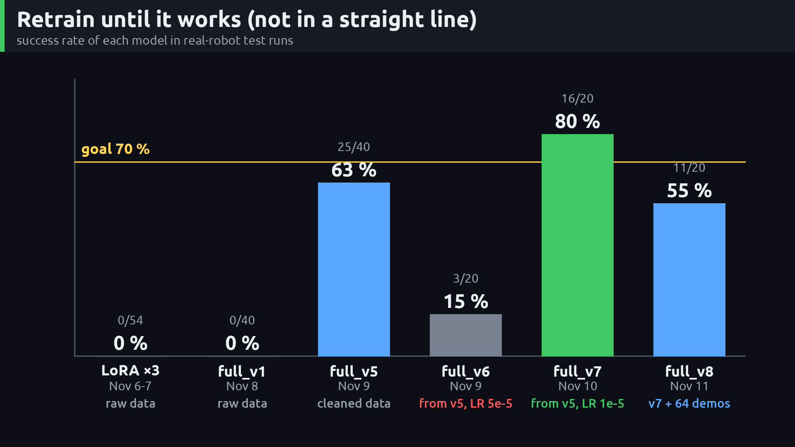
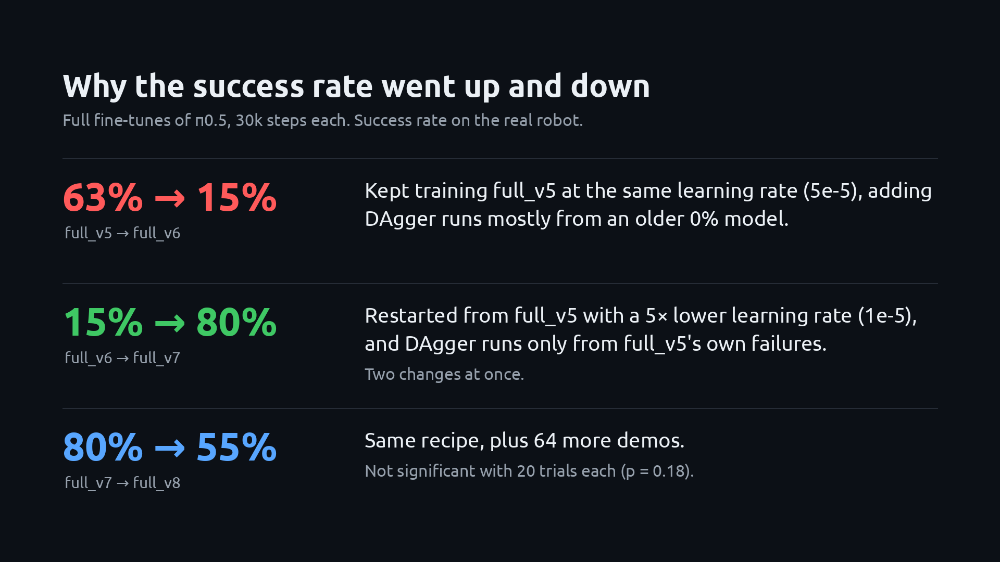
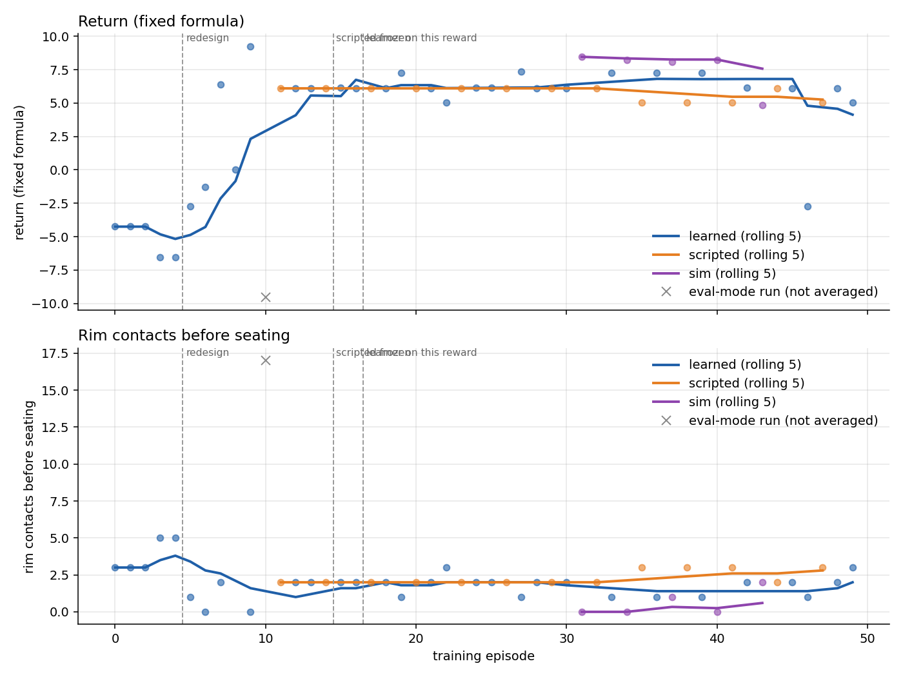

# Coding agents as robot-learning engineers: imitation learning with DAgger and real-world RL on a Kinova Gen3

Combined final report (2026-11-24). Both runs are finished: the bee run on 2026-11-11, the drawer run on 2026-11-24 at
02:42. Blocks between `<!-- BEGIN:... -->` and `<!-- END:... -->` are generated by `python3 docs/report/make_tables.py
--update --figures` from the run records. The detailed drawer chapter, with the full per-episode table, is
[drawer_lying_report.md](drawer_lying_report.md).

## Open items before submission

- [ ] Figure 1 (architecture) to draw; the bee charts (Figures 2-3) were made for the public video thread and should
      be replotted in the paper's style.
- [ ] References marked "to verify"; citations for agents that write robot code or rewards.
- [ ] `success.png` in the drawer chapter still counts episodes 0-8 and 10 as "learned" (plot script default).

## Abstract

Robot learning on real hardware is mostly chores: writing the scripted programs that collect data or reset the scene,
running resets for days, converting and cleaning data, choosing recipes, training, evaluating and noticing when
something silently breaks. We report two experiments on one Kinova Gen3 arm in which coding agents (Claude, run
headless by an orchestrator) did these chores, while a fixed robot library enforced safety and independent verdicts
(side-camera geometry plus a vision-language judge) decided success. In the first, agents collected 289 scripted
demonstrations (95 % successful), fine-tuned the vision-language-action model pi0.5 for "pick up the toy bee and put it
into the bowl", ran 267 evaluation rollouts with 117 DAgger corrections, and reached 16/20 = 80 % (95 % Wilson interval
58-92 %) against a 70 % target after 6.5 days, with 9 hands-on human interventions. In the second, agents ran
real-world reinforcement learning for inserting a drawer into a cabinet lying on its back (1-2 mm clearance): a reset
agent took the drawer out and stood it up again before every episode, and an RL agent wrote the episode program, an
AWAC learner and the reward. After its program redesign, 40 of 41 training episodes (9-49) were independent successes
(the other was a real insertion misjudged by a bug in our check), with no manual reset and one manual touch of the
scene; the fixed evaluation of the deterministic policy after 50 training episodes reached 7/10 (95 % Wilson interval
40-89 %), meeting the 70 % target. Against a frozen scripted baseline in the same run, the learned arm needed fewer rim
touches (0.76 vs 1.36 per episode, permutation p = 0.04) and fewer steps, but not a higher return; a PPO policy trained
in a simulation with an SGS-style reset curriculum, built by a separate agent, succeeded zero-shot in 5 of 5 real
episodes. Across both runs the agents were good at
writing and repairing robot programs and at diagnosing from logs; people still mattered for the decisions that saved
the most time (full fine-tuning instead of LoRA, data rules, a scripted baseline, a fixed return), for rescuing objects
that left the work cell, and for the infrastructure. We list every intervention.

## 1 Introduction

The question of this course project is how much of the human work around real-robot learning coding agents can take
over, and what remains. We built one system and used it for two kinds of learning on the same arm:

1. **Imitation learning with DAgger** (run `20261104_1510_bee`, 2026-11-04 to 11-11): an execute agent writes a scripted
   pick-and-place program, a reset agent writes the program that undoes it, the orchestrator collects demonstrations,
   a learn agent converts them, fine-tunes pi0.5 and evaluates it on the robot, and every failed rollout is corrected
   by the scripted program from where the policy stopped (DAgger).
2. **Real-world reinforcement learning** (run `20261123_1616_drawer`, 2026-11-23): a reset agent and an RL agent; the RL
   agent owns the observation and action spaces, the reward, the learner and its hyperparameters, and decides what to
   learn and what to script. A separate agent built a simulation and a PPO policy for a zero-shot sim-to-real arm.

In both, the agents never move the robot directly. They write programs; the orchestrator runs them through one robot
library that checks every motion in a model and refuses unsafe ones; success is decided by checks the agents cannot
change. A person stays at the emergency stop, and every human action is logged.

Contributions:

- A system that lets agents run imitation learning with DAgger and real-world RL end to end on one arm, with safety
  rules enforced in the library (motion model checks, keep-in and keep-out boxes, release zones, force stops) and
  independent verdicts (Section 3).
- Two real-robot results: pi0.5 at 80 % on the bee task after agent-run collection, training and DAgger (Section 4);
  drawer insertion with 1-2 mm clearance from 0/5 to consistent independent success without manual resets, with a
  frozen scripted baseline that separates program redesign from learning, and a zero-shot sim-policy arm (Section 5).
- A simulation of the lying-cabinet insertion (MuJoCo reference, Newton GPU twin) with PPO and an SGS-style
  reset-to-states curriculum, and a first real-world check of its main prediction (Section 5.4).
- An honest account of what the agents did, where people decided, and what failed, with counts for both runs
  (Section 6).

## 2 Related work

**Vision-language-action models.** pi0.5 (Physical Intelligence, 2025) is a VLA model built on a vision-language
backbone with a flow-matching action expert; we fine-tune it with the openpi code base on joint-space actions.
**Interactive imitation.** DAgger (Ross, Gordon and Bagnell, 2011) aggregates expert labels on states the learner
visits; here the expert is the agent-written scripted program, which takes over from the policy's last pose.
**Offline-to-online RL.** AWAC (Nair, Gupta, Dalal and Levine, 2020) regresses the policy on logged actions weighted by
their advantage, which suits few real transitions; the RL agent chose it. **Reset-to-states curricula.** SGS-RL
(Zhang, Guaman Castro, Yin, Dagnino, Gupta, Scalise and Boots, "A Balanced Data Diet: Addressing the Exploration
Bottleneck in Mega-Scale RL for Robot Control", CoRL 2026, arXiv 2610.12465) keeps PPO (Schulman et al., 2017)
unchanged and samples episode starts from a finite set of configurations with a Beta-shaped weight on each
configuration's recent success rate, so that experience goes to configurations of intermediate difficulty and a
simple reward suffices; it trains at very large scale and transfers zero-shot. Our simulation borrows the sampler idea
at small scale (Section 5.4). **Simulation.** MuJoCo (Todorov, Erez and Tassa, 2012) is our reference engine and
NVIDIA Newton our GPU engine for training. **Agents for robot programming.** Language models that write robot code or
rewards are an active line of work (citations to be added); our focus is the operations around learning (resets, data,
training, evaluation, safety), not the policy code.

## 3 System

### 3.1 Roles and machines

**[Figure 1 placeholder: the orchestrator on the robot PC runs reset -> episode -> verdict -> (learner | collection
counter) -> agent reflection; agents on the GPU workstation write programs in git workspaces; every motion goes through
RobotSession (model check, keep-in/keep-out, force stop, release zone, watchdog); records and the operator channel
(notes, RESTART, PHASE).]**

| Role | Bee run | Drawer run |
|---|---|---|
| Execute agent | scripted pick-and-place program (also the DAgger expert) | the RL agent: episode program, learner, reward |
| Reset agent | put bowl and bee at sampled targets, from any state | take the drawer out of the cabinet and stand it at a target |
| Learn agent | convert episodes, fine-tune pi0.5, evaluate, decide the next recipe | (the RL agent) |
| Sim worker | - | separate agent: simulation, PPO policy, baselines |
| Orchestrator | collection rounds, learn phase, evaluations with DAgger | RL loop, fixed evaluation |
| Verdict | geometric check + VLM judge | geometric check + VLM judge |

The robot PC (RTX 4090) runs the orchestrator, every robot program, the RL learner and (in the bee run) some training
and policy serving; the GPU workstation (RTX 5090) runs the agents (headless Claude Code, model Claude Opus 5.5), the
VLM judge and part of the training and serving. Agents cannot reach the arm. The hardware is a Kinova Gen3 (6 joints)
with a parallel-jaw gripper and a wrist colour camera, plus a fixed side RGB-D camera.

### 3.2 Agents and the turn protocol

Each agent is a persistent Claude Code session with its own git workspace. A turn ends with one structured action:
`run` a command (flagged if it moves the robot), `done`, `need_operator` or `give_up`. On `run`, the orchestrator syncs
the workspace to the robot PC, runs the command as a recorded attempt, and resumes the session with a digest (exit
code, the program's summary, log tail, saved images). Workspaces deny writes outside themselves and any command that
mentions the motion switch or remote shells. In autonomous mode, a `need_operator` request gets a standing reply ("do
it with the robot or skip it"), so nobody is asked to act. Between robot runs the agents get reflection turns (no
robot), and repair turns when their program fails repeatedly. Operator notes are delivered once at the start of the
agent's next turn and logged.

### 3.3 Loops

**Bee (collection, learning, evaluation).** check -> develop execute -> develop reset -> collect (rounds of 100
successful episodes: reset to sampled targets, layout check, recorded execute run, verdict) -> learn (the learn agent
converts episodes to LeRobot, trains, and calls evaluations) -> collect more, until an evaluation reaches the target.
An evaluation runs N policy rollouts with resets in between; after a failed rollout, DAgger runs the execute program
from the policy's last pose as a recorded `dagger` episode, which can be added to the next dataset.

**Drawer (RL).** check -> develop reset -> develop the RL program -> RL training: reset -> episode -> verdict (written
for the learner) -> learner update -> the agent's reflection on the episode while the next reset runs; a tuning turn
every 5 episodes; one fixed evaluation after 50 training episodes.

A restart file makes the orchestrator exit at the next safe point; a launcher loop relaunches it, so configuration
changes take effect without losing state. A phase file redirects the run (for example back to collection while a
model trains).

### 3.4 Safety library

Every program, scripted or learned, moves the arm only through `RobotSession` (`rlpj/robot/session.py`):

- Every segment and every policy chunk is checked in a kinematic model before it is sent: joint limits, speed, table
  clearance (fingertip margin), the base column, reach, a work-cell **keep-in box** for every gripper point, and the
  task's **keep-out boxes** (drawer run: cabinet body and walls). Refused motions do not run.
- Tracking aborts at 1 deg or 10 mm deviation; a watchdog process homes the arm if a program dies (since 11-09 a
  program does not move until the watchdog reports that it is up); programs return home along a checked path.
- A **force stop** ends a segment above a task limit (drawer: 65 N cap, programs may only lower it; the RL program used
  20-25 N, the sim arm 35 N).
- A **release zone** (bee): the gripper may not open on the held bee outside the table's safe middle or higher than
  20 cm above it (since 11-10 also when the wrist image shows the bee on the fingers).
- A **gripper check** after every program (bee): colour share at the fingertips in the wrist image; a bee stuck on the
  gripper skips the episode, and two in a row stop the run before the bee falls.
- Motion needs a switch that only the orchestrator sets, after printing the command and a countdown. Without it every
  program is a dry run that still plans, checks and writes replay videos.

Most of these rules were added after an incident in the bee run (Table 4.2); the drawer run started with all of them.

### 3.5 Independent verdicts

A program's own claim is logged but never trusted alone. For collection episodes (bee) success needs the claim and at
least one independent yes with no independent no; for policy rollouts and RL episodes (no claim of their own) both
independent checks must say yes, one yes is `unsure`, none is `fail`. The checks are a task-specific geometric test on
the side-camera point cloud (`rlpj/success/checks.py`: bee inside the bowl; drawer flush in the target compartment, no
drawer on the table, cabinet not moved) and a VLM judge (Claude) that reads the before and after images of both
cameras with the task's success sentence. The drawer run also asks the VLM after every reset whether the drawer stands
the right way up.

### 3.6 Records

Every robot program writes a dashboard video (side and wrist cameras with the program log); episodes store both videos
at 15 fps, joint states and commands, phases, images and the program summary. The orchestrator logs every phase, agent
action, attempt, reset, episode, note and restart (`events.jsonl`) and the cost of every agent turn and VLM call
(`usage.jsonl`), and copies the agents' full transcripts. Human interventions and mid-run changes are kept by hand in
`OPERATOR_LOG.md`.

## 4 Experiment 1: pick-and-place with pi0.5, imitation learning and DAgger

### 4.1 Task

A toy bee (about 11 x 8 cm, 4 cm tall lying down) and a bowl (15 cm across, 7 cm tall) lie on the table. Instruction
(also the pi0.5 prompt): "pick up the toy bee and put it into the bowl". Success: the bee rests in the bowl, the bowl
stands upright, the gripper is clear. The only specification the agents got was this text (condition `text`). Target:
at least 90 % in a fixed evaluation, lowered to 70 % by user decision on 11-07. Resets sample bowl and bee positions in
the table's middle (bowl x 0.40-0.54 m, y -0.17..0.05 m; bee x 0.38-0.56 m, y -0.20..0.06 m, at least 18 cm apart).

### 4.2 Programs written by the agents

The execute agent's pick-and-place program succeeded on its first robot run, 5.7 minutes of agent time after the
start, and later collected 275 of 289 demonstrations successfully (95 %). The reset program was the hard part: the
bowl is wider than the gripper opens and must be moved by pinching its rim, and the bee sticks to the fingertips. The
reset agent made 69 robot test runs and 62 repairs over the run; the orchestrator ran 678 resets, of which 544 passed
the layout check and none was done by hand.

### 4.3 Policy, training and data

pi0.5 is fine-tuned with openpi on joint-space data: state = 6 joint angles (rad) + gripper reading, actions = absolute
joint targets + gripper command (the 6 joints converted to deltas by openpi), images = side and wrist (224 x 224), 15 fps,
prompt = the instruction. At rollout time the policy returns a chunk of 10 joint targets; each chunk is model-checked
and streamed with the executor's tracker (limits: work cell, 10 cm/s, 20 deg/s, deviation, time limit). The learn
agent started with LoRA fine-tunes; after the 11-07 user decision ("full fine-tuning only, at least 30k steps") the
operator side set up full fine-tuning in PyTorch (bf16, gradient checkpointing, 8-bit AdamW) that fits a 24 GB GPU at
batch 4 (about 1 step/s, 8-9 h per 30k-step run).

<!-- BEGIN:bee_data -->
<!-- generated by docs/report/make_tables.py from runs/20261104_1510_bee at 2026-11-24 03:10 -->

| Dataset | Created | Episodes | Demos | DAgger | Frames (15 fps) | Converter options |
|---|---|---|---|---|---|---|
| bee_v3 | 11-07 08:48 | 139 | 112 | 27 | 247,114 | - |
| bee_v4 | 11-08 04:57 | 166 | - | - | 295,891 | - |
| bee_v5 | 11-08 14:32 | 94 | 94 | 0 | 87,041 | wrist=normal, start_phase=approach, drop_idle=True |
| bee_v6 | 11-09 01:27 | 123 | 105 | 18 | 117,532 | wrist=normal, start_phase=approach, drop_idle=True |
| bee_v7 | 11-09 13:43 | 133 | 105 | 28 | 127,483 | wrist=normal, start_phase=approach, drop_idle=True |
| bee_v8 | 11-09 23:06 | 113 | - | - | 105,550 | wrist=normal, start_phase=approach, drop_idle=True |
| bee_v9 | 11-10 11:39 | 177 | 169 | 8 | 164,743 | wrist=normal, start_phase=approach, drop_idle=True |
<!-- END:bee_data -->

Earlier datasets had no manifest in this form: bee_v1 (100 demonstrations, 176,072 frames) and bee_v2 (bee_v1 + 14
DAgger corrections). bee_v8 is 105 normal-wrist demonstrations + 8 corrections of full_v5's own failures (from the
learn notes; its manifest does not record the modes).

**Table 4.1** Training runs (from `OPERATOR_LOG.md`, the learn notes and the evaluation files).

| Run | Data | Init | Recipe | Result |
|---|---|---|---|---|
| lora_v1 | bee_v1 | pi05_base | LoRA, 15k steps, batch 16, constant LR 5e-5 | 0/32 |
| lora_h30 | bee_v2 | lora_v1 | LoRA, action horizon 30, 12k steps | 0/20 |
| lora_v3 | bee_v3 | - | LoRA, sin/cos encoding of the wrapping wrist joints | 0/2 (screen) |
| lora_v4 | bee_v3 | - | LoRA, gripper-only state | stopped at 7.3k, not evaluated |
| full_v1 | bee_v3 (112 demos + 27 corrections) | pi05_base | full, 30k, batch 4, LR 5e-5 | 0/41 |
| full_v4 | bee_v4 | - | full (learn agent's recipe) | stopped at 21.2k when the data problem was found |
| full_v5 | bee_v5 (94 cleaned demos) | full_v1 | full, 30k, LR 5e-5 | 25/40 at 240 s (evals 18-19); 34/70 pooled |
| full_v6 | bee_v6 (105 demos + 18 corrections, mostly of full_v1) | full_v5 | full, 30k more at LR 5e-5 | 7/60 |
| full_v7 | bee_v8 (105 demos + 8 corrections of full_v5) | full_v5 | full, 30k, constant LR 1e-5 | **16/20** |
| full_v8 | bee_v9 (bee_v8 + 64 new demos) | full_v5 | as full_v7 | 11/20 |

### 4.4 Evaluation protocol and DAgger

An evaluation is 20 rollouts (fewer in screens), each after a reset, each judged by both independent checks. From
11-08 every rollout starts with a scripted move that puts the wrist camera over the bowl (the "look pose"); then the
policy drives until it releases the bee or a time limit (150 s, 240 s from 11-09 by user decision). After a failed
rollout the execute program finishes the task from the policy's last pose as a recorded DAgger episode. The protocol
changed during the run (rollout program, time limit, policy host, room lighting), so only evaluations under the same
conditions are compared.

<!-- BEGIN:bee_summary -->
<!-- generated by docs/report/make_tables.py from runs/20261104_1510_bee at 2026-11-24 03:10 -->

- Span: 2026-11-04 15:10 to 2026-11-11 03:01 (156 h).
- Demonstrations (scripted program, collection mode): 289 (275 success, 12 fail, 2 unsure); unsure episodes discarded and redone: 4.
- Policy rollouts in evaluations: 267 (68 success, 189 fail, 10 unsure). DAgger corrections: 117 (85 success, 27 fail, 5 unsure).
- Resets: 678 (layout check ok 544, failed 134, manual 0).
- Agents: execute 1 robot test runs, 0 repairs, 295 reflections; reset 69 robot test runs, 62 repairs, 298 reflections; learn 0 robot test runs, 0 repairs, 0 reflections.
- Operator notes: 52 (execute 7, learn 27, reset 18); restarts 18; autonomous stops 8; phase overrides 10.
<!-- END:bee_summary -->

### 4.5 Results

<!-- BEGIN:bee_evals -->
<!-- generated by docs/report/make_tables.py from runs/20261104_1510_bee at 2026-11-24 03:10 -->

| Eval | Checkpoint | Start | Rollouts | Unsure | Success [95 % Wilson] | DAgger ok/total | Rollout program |
|---|---|---|---|---|---|---|---|
| 01 | lora_v1/14999 | 11-06 02:27 | 0 | 0 | no rollout | 0/0 | - |
| 02 | lora_v1/14999 | 11-06 02:34 | 0 | 0 | no rollout | 0/0 | - |
| 03 | lora_v1/14999 | 11-06 11:30 | 12 | 0 | 0/12 = 0 % [0, 24] | 0/0 | - |
| 04 | lora_v1/14999 | 11-06 18:09 | 20 | 0 | 0/20 = 0 % [0, 16] | 14/18 | rollout_v2.py |
| 05 | lora_h30/11999 | 11-07 05:07 | 20 | 1 | 0/20 = 0 % [0, 16] | 13/16 | rollout_v3.py |
| 06 | lora_v3/4500 | 11-07 12:11 | 2 | 0 | 0/2 = 0 % [0, 66] | 1/2 | rollout_v3.py |
| 07 | full_v1/30000 | 11-08 02:32 | 0 | 0 | no rollout | 0/0 | - |
| 08 | full_v1/30000 | 11-08 02:33 | 20 | 0 | 0/20 = 0 % [0, 16] | 5/17 | rollout_std.py |
| 09 | full_v1/30000 | 11-08 13:06 | 0 | 0 | no rollout | 0/0 | rollout_look.py |
| 10 | full_v1/30000 | 11-08 13:22 | 0 | 0 | no rollout | 0/0 | rollout_look.py |
| 11 | full_v1/30000 | 11-08 13:48 | 1 | 0 | 0/1 = 0 % [0, 79] | 1/1 | rollout_look.py |
| 12 | full_v1/30000 | 11-08 14:02 | 20 | 1 | 0/20 = 0 % [0, 16] | 13/13 | rollout_look.py |
| 13 | full_v5/30000 | 11-08 22:59 | 20 | 1 | 7/20 = 35 % [18, 57] | 4/6 | rollout_look.py |
| 14 | full_v6/30000 | 11-09 09:03 | 20 | 2 | 2/20 = 10 % [3, 30] | 8/10 | rollout_look.py |
| 15 | full_v5/30000 | 11-09 12:05 | 10 | 0 | 2/10 = 20 % [6, 51] | 2/2 | rollout_look.py |
| 16 | full_v6/30000 | 11-09 13:56 | 20 | 2 | 2/20 = 10 % [3, 30] | 10/12 | rollout_look.py |
| 17 | full_v6/30000 | 11-09 16:49 | 20 | 0 | 3/20 = 15 % [5, 36] | 5/7 | rollout_look.py |
| 18 | full_v5/30000 | 11-09 20:13 | 20 | 1 | 13/20 = 65 % [43, 82] | 2/2 | rollout_look.py |
| 19 | full_v5/30000 | 11-09 23:23 | 20 | 0 | 12/20 = 60 % [39, 78] | 2/3 | rollout_look.py |
| 20 | full_v7/30000 | 11-10 09:01 | 1 | 1 | 0/1 = 0 % [0, 79] | 0/1 | rollout_look.py |
| 21 | full_v7/30000 | 11-10 09:28 | 0 | 0 | no rollout | 0/0 | rollout_look.py |
| 22 | full_v7/30000 | 11-10 15:40 | 20 | 0 | 16/20 = 80 % [58, 92] | 1/2 | rollout_look.py |
| 23 | full_v8/30000 | 11-10 23:45 | 20 | 1 | 11/20 = 55 % [34, 74] | 4/5 | rollout_look.py |

Pooled over all evaluations of a checkpoint (conditions differ between evaluations, see the text):

| Checkpoint | Success [95 % Wilson] |
|---|---|
| lora_v1/14999 | 0/32 = 0 % [0, 11] |
| lora_h30/11999 | 0/20 = 0 % [0, 16] |
| lora_v3/4500 | 0/2 = 0 % [0, 66] |
| full_v1/30000 | 0/41 = 0 % [0, 9] |
| full_v5/30000 | 34/70 = 49 % [37, 60] |
| full_v6/30000 | 7/60 = 12 % [6, 22] |
| full_v7/30000 | 16/21 = 76 % [55, 89] |
| full_v8/30000 | 11/20 = 55 % [34, 74] |

Final comparison (last evaluation of each, same protocol): full_v7 16/20 vs full_v8 11/20, two-sided Fisher exact p = 0.18.
<!-- END:bee_evals -->

**Figure 2.** Success of each model in real-robot evaluations (made for the public video thread; full_v5 shows evals 18
and 19 at 240 s). 

**Figure 3.** What changed between the full fine-tunes (same source). 

The final checkpoint full_v7/30000 reached 16/20 = 80 % (Wilson interval 58-92 %), above the 70 % target, in
evaluation 22 (2026-11-10). full_v8, the same recipe with 64 more demonstrations, scored 11/20 under the same protocol;
the difference is not significant (two-sided Fisher exact p = 0.18).

### 4.6 What changed the success rate

The record shows four kinds of causes, in the order they mattered:

1. **Data that contradicted the rollout.** full_v1 (0/41) replayed the demonstrations' opening move toward a camera
   view of the bowl, which swings the tool toward the curtain; after the keep-in box was added, 16 of 20 rollouts of
   evaluation 08 were stopped at the same spot. The operator side then found three data problems: 106 of 112 bee_v3
   demonstrations passed through the other of the arm's two wrist solutions at the look pose while rollouts used the
   normal one; 37 % of the frames were idle (perception pauses), which a single-frame policy cannot time; and the
   opening move was not the policy's job. Converter options for one wrist solution, dropping idle frames and starting
   at the approach phase produced bee_v5, and full_v5 went from 0 % to 35-65 %.
2. **Rollout-side fixes.** Several rollouts of full_v5 grasped the bee and were then stopped by the library: a closed
   gripper's fingertips are modelled 9 mm too low (lifts refused at the table floor), the plan started from joints read
   before inference while the arm was still settling, chunks started with a jump (tracking deviation), and an early
   release outside the zone ended the rollout. These were fixed between evaluations 13 and 17, and the time limit went
   from 150 to 240 s; full_v5 scored 7/20 in evaluation 13 and 25/40 in evaluations 18-19.
3. **The recipe.** full_v6 continued full_v5 at the same learning rate on more data, mostly corrections of the 0 %
   model full_v1, and fell to 7/60. The learn agent then chose full_v7's recipe itself, after an operator note listing
   the evidence: restart from full_v5, learning rate 5 x lower (1e-5), and only corrections of full_v5's own failures.
   It reached 80 %. Two things changed at once, so the record cannot say which mattered.
4. **More demonstrations did not help** (full_v8, 11/20 vs 16/20, not significant).

Evaluation conditions also moved the numbers: one evaluation of full_v6 ran in a dark room, where the VLM rejected a
real success; policy serving moved between the two GPUs; the rollout program changed. We therefore compare checkpoints
only within matching conditions (evaluations 18-19 vs 17; 22 vs 23).

### 4.7 Human involvement

The robot could not continue without a person 9 times (Table 4.2); 7 of these were the bee leaving reach or sticking to
the gripper, one was a network failure and one the arm grasping the curtain. Most ended with a new system rule, so most
kinds of incident happened once. From 11-08 on there was only one more (11-10).

**Table 4.2** Hands-on interventions in the bee run (from `OPERATOR_LOG.md`).

| # | When | What happened | What the person did | Rule added afterwards |
|---|---|---|---|---|
| 1 | 11-04 20:39 | a reset parked the bee near the robot base, where the side camera barely sees it; resets failed with "bee not found" | put the bee back | bee targets only in the well-seen middle |
| 2 | 11-04 21:55 | the bee stayed on a fingertip after release and rode along for two resets | took it off the gripper | stuck-bee check in the reset program |
| 3 | 11-04 22:01 | the bee was put down at 0.75 m, beyond the reset program's 0.62 m limit | moved the bee closer | measured reach in the program |
| 4 | 11-04 23:29 | the bee wedged between the fingers, was carried and fell to the floor | put it back on the table | orchestrator gripper check after every program |
| 5 | 11-05 02:43 | the bee stuck to a fingertip and fell off the curtain-side edge; 8.5 h stop overnight | put it back, wrapped in orange tape (it had broken) | release zone in the library |
| 6 | 11-06 02:38 | the robot's network link went down during the first policy evaluation | rebooted the arm | - |
| 7 | 11-06 13:22 | a rollout held the bee by its tip; the reset's carry dropped it | put the bee back | a held bee is set down straight below, never carried |
| 8 | 11-07 12:35 | a rollout grasped the curtain; the next reset dragged it, the arm faulted and the side camera moved | cleared the fault; camera realigned and recalibrated | work-cell keep-in box for every motion and chunk |
| 9 | 11-10 09:10 | after a rollout the bee hung on the gripper; the DAgger run dropped it and it left the table | put it back at 13:03 | release check also uses the wrist image |

Beyond these, people made the decisions that saved the most time: the success target (90 -> 70 %), full fine-tuning
only with at least 30k steps, adding DAgger, the 240 s time limit, which GPU to train on, and evaluating full_v8. The
operator side (the student and a supervising coding assistant) sent 52 notes and made many logged system changes: the
data diagnosis and converter options of item 1 above, the full fine-tuning setup, rollout-library fixes, two side
camera recalibrations with hand-run scripts, disk cleanups and moves when partitions filled, recovery from a GPU that
lost power under load, a renewed agent login, a light switched on, and orchestrator bug fixes (a rollout could never
score a success under the first verdict rule; GPU jobs were killed by the robot time limit; polling scripts were
counted as training runs).

### 4.8 Cost and time

<!-- BEGIN:bee_cost -->
<!-- generated by docs/report/make_tables.py from runs/20261104_1510_bee at 2026-11-24 03:10 -->

| Item | Calls | Turns | Minutes | Output tokens | Cost (USD, API list price) |
|---|---|---|---|---|---|
| reset agent | 435 | 1467 | 129 | 700 k | 814.21 |
| execute agent | 301 | 821 | 103 | 354 k | 709.09 |
| learn agent | 81 | 374 | 59 | 208 k | 98.04 |
| VLM judge | 678 | - | 74 | - | 22.90 |
| total |  | 2662 | 291 | 1263 k | 1644.24 |

As of 03:01: wall time 155.8 h since the run was created, robot programs 4557 min, agent turns 291 min.
<!-- END:bee_cost -->

The run took 156 hours of wall time (6.5 days) and 76 hours of robot programs. The execute and reset agents'
reflections after every run were the largest part of the agent cost: the operator's later estimate was about 82 % of
the run's cost, for one program change, so per-run reflections were switched off for later runs of this kind.
Training time on the GPUs is only partly in these totals, because the full fine-tunes ran as detached jobs (8-9 h each).

## 5 Experiment 2: real-world RL for drawer insertion, with a sim-to-real arm

This section summarizes the drawer run; [drawer_lying_report.md](drawer_lying_report.md) has the full method, the
per-episode table, every revision and every intervention.

### 5.1 Task and the prior attempt

A wooden cabinet (outer 275 x 139 mm, rim 95 mm) lies on its back on the table, three compartments open to the top. The
drawer (top face 72-73 x 110-113 mm, 91 mm long) stands on its back wall beside the cabinet, pull up; the task is to
insert it into the compartment nearest the robot (opening 75.7 x 115 mm, so 1-2 mm per side) until flush. A first
attempt with the cabinet standing (horizontal push into the bottom slot, 2026-11-17 to 11-21) had 0/30 training
episodes and 0/5 in evaluation: jams at 50-95 N, a cabinet moved by a 100 N snag, slot positions from side-camera
blobs about 2 cm off. Lessons carried over: locate targets with wrist look-downs, enforce rules in the library, measure
the geometry right before the run, and use gravity (cabinet lying, user decision).

### 5.2 Setup

Before the run the side camera, moved by 131 mm, was recalibrated by an automated program (the arm finds a ChArUco
board with the wrist camera and visits 12 model-checked views; 11 used, spread 9.7 mm), and a measurement program took a
clean side cloud and a wrist look-down of the cabinet. Reset targets: x 0.26-0.28 m, y -0.03..-0.01 m, at least 14 cm
from every table edge.

### 5.3 Method

**Reset program** (reset agent): pinch the pull, lift in two stages with re-grip checks, carry, lower under a 20 N
limit, release at least 10 cm inside the table edges, verify with the orchestrator's own side-camera measurement.

**Episode program** (RL agent): measure the opening with a wrist look-down before the grasp; find the drawer and the
pull; pinch the pull; carry and hold the drawer 8 mm above the rim at the measured opening plus a start offset; insert;
release; verify. The insertion is a loop of model-checked steps with a 25 N force stop. The learned part is a bounded
residual (corrections along the opening's two axes, yaw, and the descent step size) on a straight-down prior. On a rim
touch the program lifts 4 mm and moves to the next point of a scripted **touch search** that follows the contact height
(line searches along each axis, then a spiral over +-15 mm, at most 36 touches).

**Learner** (RL agent): AWAC with twin critics (2 x 128 MLPs), discount 0.95, a decaying pull to the zero-residual
prior, all data replayed after every episode. Two learner problems were found and fixed by the agent during the run:
the critic diverged with an auto-tuned entropy term on nearly constant logged actions (fixed after episode 16); and
AWAC can only copy logged actions, so the first descent never moved toward where the drawer entered. After an operator
note suggesting hindsight relabelling, the agent first added synthetic first-descent transitions, then found that
their targets were just the search's first step and replaced them with replay of the real episodes that entered on the
first descent (learner version 5, from episode 33).

**Reward.** The agent's own reward saturated at about 14 per success; from episode 17 the agent uses a fixed formula
that is also the report's metric: +10 for a success by the verdict, -1 per force stop (rim touches and the final stop on
the floor), -0.1 per N of the last step's peak above 15 N, -0.05 per step.

**Arms.** Every training episode with index % 3 == 2 from episode 11 runs the same program with the residual off and no
exploration (**scripted baseline**); its scripted part was frozen (constant start offset) from episode 15. Episodes 31,
34, 37, 40 and 43 run the simulation's PPO policy unchanged in place of the residual and touch search (**sim arm**);
all others are the **learned** arm. The comparison window is episodes 17 and later (frozen script, repaired learner,
same reward).

### 5.4 Simulation: PPO with an SGS-style reset curriculum

A separate agent (the "sim worker", started by the operator at 16:33, finished at 18:32) built the simulation in
`sim/drawer_insert/` (README section "Lying cabinet"); the RL agent did not use it on its own initiative.

**Model.** MuJoCo 3.17 (1 ms steps, implicit-fast integration, elliptic cones) models only the descent: a hand with
four position-servoed joints (x, y, z, yaw) carries the drawer through a compliant pinch at the pull (spring and Coulomb
slip joints for slide, two tilts and yaw); the compartment has a floor, four walls with rounded rim edges and the
middle compartment beyond the divider. A Newton GPU twin parses the same model into 4096 parallel worlds for training;
on 1024 matched episodes of a straight descent the two engines agree on 97.5 % of outcomes (11.7 % success each, median
depth difference 0.07 mm). **Domain randomization** covers the opening size (clearance 2-6 mm per axis), rim height,
drawer length, edge rounding, mass, friction, the opening pose error (+-10 mm, +-3 deg), the in-hand offset, yaw and tilt
(up to 8 deg), wrist-estimate errors, grasp compliance, arm stiffness, force-estimate bias, drift and noise, the force-stop
level (40-65 N) and the start height. **Observation**: commanded tool pose in the believed opening frame, wrist
estimates of the in-hand pose, force change since the descent started, last peak, stop flag, previous action, step
index. **Action**: one bounded step per decision (+-4 mm, +-2 deg, -8..+4 mm in height), 60 decisions. **Reward**:
depth gain, lateral progress toward the true opening centre (privileged shaping), a force penalty and a success bonus.

**What we implemented of SGS.** PPO is unchanged: 2 x 256 tanh MLPs, Gaussian policy with a state-independent standard
deviation (starting at 0.5, clamped to 0.05-1.0), discount 0.99, GAE 0.95, clip 0.2, 4 epochs, minibatch 4096, Adam
3e-4, entropy coefficient 0.001, value-loss weight 0.5, gradient clipping 1.0; the actor's last layer starts at
"descend 5 mm per step". The SGS-style part is the start sampler (`sim/drawer_insert/curriculum.py`): a bank of start
configurations (max(4096, 4 x the number of worlds), i.e. 16,384 entries in the 4096-world runs), each a parameter
seed, a start variant and an optional scripted pre-roll (a straight descent or a descent with random lateral and yaw
steps of 2-29 decisions, leaving the drawer on the rim, cocked or part-way in). Each entry keeps a running success
estimate p (step 0.5 at the first visit, then 0.25); entries are drawn with weight (p + 0.05)^2 (1 - p + 0.05)^2, a
symmetric Beta-shaped kernel that peaks at p = 0.5, with unvisited entries at the maximum weight; mastered (p > 0.95
after 4 visits) and hopeless (p < 0.02 after 12 visits) entries are replaced. 40 % of each batch are fresh starts from
the evaluation distribution. Unlike SGS-RL, the weights are normalized directly (no softmax temperature), the bank is
small, and training runs on a single GPU.

**Training.** Four Newton runs chained by fine-tuning (3.7, 4.8, 13.3 and 22.2 M samples; 8, 9, 30 and 47 minutes on
the RTX 4090); the shipped policy (run ly_n4, iteration 100) reached 76.5 % on 4096 deterministic starts. A first run
with a stronger force penalty collapsed to hovering above the rim.

**Results** (500 MuJoCo episodes per cell, the same episodes for every controller):

<!-- BEGIN:sim -->
<!-- generated by docs/report/make_tables.py from runs/20261123_1616_drawer at 2026-11-24 03:10 -->

500 episodes per cell (MuJoCo CPU reference, seeds 100000-100499, same episodes for every controller).

| Start / variant | Straight descent | Spiral search | Force-guided script | PPO policy |
|---|---|---|---|---|
| carry (full ranges) | 21.0 % | 14.0 % | 59.6 % | 74.8 % |
| carry, released when seated | 15.6 % | 9.4 % | 49.2 % | 70.2 % |
| small (opening +-3 mm / +-1 deg) | 46.2 % | 32.8 % | 78.4 % | 94.8 % |
| big_open (opening +-15 mm / +-5 deg) | 9.2 % | 5.8 % | 43.2 % | 52.6 % |
| after 8 straight-descent steps | 21.0 % | 14.4 % | 59.4 % | 76.2 % |
| after 10 drift steps | 19.2 % | 15.0 % | 56.8 % | 73.6 % |

Stress tests (carry start):

| Start / variant | Straight descent | Spiral search | Force-guided script | PPO policy |
|---|---|---|---|---|
| force noise sd 3-5 N, bias +-6 N | 18.4 % | 10.8 % | 53.6 % | 56.4 % |
| clearance 1-2 mm | 5.4 % | 3.8 % | 30.8 % | 48.0 % |
| in-hand estimate sd 5-10 mm, 3-6 deg | 8.2 % | 5.2 % | 39.8 % | 50.6 % |
| tilt estimate passed as zero | 21.6 % | 12.0 % | 61.6 % | 72.2 % |
| friction 0.6-0.9 | 17.8 % | 10.6 % | 66.4 % | 71.4 % |
| loose grasp | 20.0 % | 12.8 % | 57.6 % | 78.0 % |
| arm 5e3-2e4 N/m | 32.4 % | 20.2 % | 50.8 % | 69.6 % |
| decision period 0.5-1.0 s | 21.4 % | 16.0 % | 59.8 % | 74.2 % |
| force stop 25-40 N | 16.8 % | 12.6 % | 65.4 % | 72.8 % |

Policy on carry starts: median true peak force 74 N, 6.9 force stops per episode, median 23 decisions to the first success state.

Newton vs MuJoCo (straight descent, 1024 carry episodes): success 11.7 % vs 11.7 %, per-episode agreement 97.5 %, median depth difference 0.07 mm.
<!-- END:sim -->

In contact, the policy's lateral steps point along the measured lateral force (mean cosine 0.95): it learned a
force-guided search, and a hand-written force-guided script is the strongest baseline (59.6 % against the policy's
74.8 % on the full-range starts).

**What the evidence says about SGS.** We credit the simulation result to "PPO with an SGS-style curriculum", not to SGS
alone. No ablation was run for the lying-cabinet simulation. On the earlier standing-cabinet simulation the same
sampler was ablated from scratch: 95.4 % with the reset-to-states bank vs 95.9 % with plain nominal starts (README runs
`abl_sgs`, `abl_fresh`; 94.2 vs 94.0 % from jammed starts, 93.4 vs 91.2 % from cocked starts). There a straight-push
prior already reached the jams, so exploration was not the bottleneck SGS targets; the curriculum was kept because it
did not hurt and covers jammed and part-way states explicitly.

**Sim-to-real gap and risks.** The main error source on the robot was the opening position (1.5 cm between the yaml
and the wrist measurement, against 1-2 mm of clearance); the simulation shows that the policy's success falls with that
start error (92-93 % below 6 mm, 26 % above 15 mm). Other risks named by the sim worker: the real force estimate (joint
torques, pose-dependent bias), the grasp (modelled as springs with guessed slip torques), the in-hand tilt estimate
(not measurable on the robot and passed as zero, about -3 points in simulation), wood friction and swelling, and a fixed
cabinet. On the robot the sim arm started from the measured opening plus the same frozen start offset as the scripted
arm, so its start error was small, the regime where the simulation predicts 94.8 %.

### 5.5 Results

<!-- BEGIN:summary -->
<!-- generated by docs/report/make_tables.py from runs/20261123_1616_drawer at 2026-11-24 03:10 -->

- Training episodes: 50 (indices 0-49); counted successes 41; unsure 3 (5, 6, 46); failures 6.
- Drawer seated at the compartment floor (program log): 44 episodes (5-7, 9-49).
- First counted success: episode 7 at 19:04.
- Episodes >= 9: 40/41 = 98 % [87, 100].
- Time between consecutive training episodes: median 5.9 min, 3 gaps over 15 min.
- Per arm: pre-arm 1/9; learned 21/22; scripted 13/13; sim 5/5; learned (eval mode) 1/1.
<!-- END:summary -->

The first five episodes ended with the drawer resting on the rim: the opening position was off by more than the
clearance, the opening detector often failed, and an alignment from a wrist image at the hover could not work because
the held drawer hides the opening. After the redesign (opening measured before the grasp, hover correction dropped,
start offset from the contact heights of a probe grid, touch search) the drawer went in from episode 5 on. Episodes 5
and 6 were real insertions scored `unsure` by a bug in our cabinet-moved test (a filled compartment shifts the blob
centroid; fixed to the outline centre); episode 8 failed to find the pull in a blurred image. Episode 46 was a real
flush insertion scored `unsure` for a second checking bug: the geometric check took the standing drawer for the cabinet
("cabinet moved 27.1 cm"); it now picks the cabinet by size (commit `f34607a`, restart 23:58), so episodes 48-59,
including the evaluation, were scored with the fixed check.

**Learned vs scripted vs sim** (mean +- standard deviation per episode; success with 95 % Wilson intervals;
permutation tests on per-episode values):

<!-- BEGIN:arms -->
<!-- generated by docs/report/make_tables.py from runs/20261123_1616_drawer at 2026-11-24 03:10 -->

All training episodes (50):

| Arm | Episodes | Success [95 % Wilson] | Rim touches | Force stops | Max N | Steps | Duration (s) | Fixed return |
|---|---|---|---|---|---|---|---|---|
| pre-arm | 9 | 1/9 = 11 % [2, 44] | 2.6 ± 1.9 | 2.8 ± 1.8 | 28.2 ± 3.5 | 10.8 ± 5.4 | 115 ± 25 | -2.61 ± 4.01 |
| learned | 22 | 21/22 = 95 % [78, 99] | 0.8 ± 0.6 | 1.7 ± 0.7 | 28.0 ± 3.9 | 16.9 ± 1.6 | 126 ± 5 | 6.02 ± 2.15 |
| learned (eval mode) | 1 | 1/1 = 100 % [21, 100] | 17.0 | 17.0 | 29.3 | 51.0 | 162 | -9.55 |
| scripted | 13 | 13/13 = 100 % [77, 100] | 1.3 ± 0.5 | 2.3 ± 0.5 | 29.2 ± 1.9 | 18.3 ± 0.5 | 128 ± 6 | 5.78 ± 0.50 |
| sim | 5 | 5/5 = 100 % [57, 100] | - | 0.6 ± 0.9 | 36.6 ± 5.7 | 15.0 ± 1.7 | 128 ± 2 | 7.57 ± 1.53 |

Comparison window, training episodes >= 17 (33 so far):

| Arm | Episodes | Success [95 % Wilson] | Rim touches | Force stops | Max N | Steps | Duration (s) | Fixed return |
|---|---|---|---|---|---|---|---|---|
| learned | 17 | 16/17 = 94 % [73, 99] | 0.8 ± 0.7 | 1.8 ± 0.7 | 28.3 ± 1.9 | 16.8 ± 1.8 | 128 ± 3 | 5.81 ± 2.32 |
| scripted | 11 | 11/11 = 100 % [74, 100] | 1.4 ± 0.5 | 2.4 ± 0.5 | 29.1 ± 2.0 | 18.4 ± 0.5 | 130 ± 3 | 5.72 ± 0.53 |
| sim | 5 | 5/5 = 100 % [57, 100] | - | 0.6 ± 0.9 | 36.6 ± 5.7 | 15.0 ± 1.7 | 128 ± 2 | 7.57 ± 1.53 |

Window >= 17 (learned 18, 19, 21, 22, 24, 25, 27, 28, 30, 33, 36, 39, 42, 45, 46, 48, 49; scripted 17, 20, 23, 26, 29, 32, 35, 38, 41, 44, 47): rim touches 0.76 vs 1.36 (permutation p = 0.037); fixed return 5.81 vs 5.72 (permutation p = 0.956); steps 16.8 vs 18.4 (permutation p = 0.007).

Episodes >= 32 (learner v5) (learned 33, 36, 39, 42, 45, 46, 48, 49; scripted 32, 35, 38, 41, 44, 47): rim touches 0.62 vs 1.67 (permutation p = 0.023); fixed return 5.30 vs 5.40 (permutation p = 1.000); steps 16.5 vs 18.7 (permutation p = 0.023).
<!-- END:arms -->

Up to episode 18 the arms behaved identically (one rim touch, entry one 3 mm search step further, a floor stop). In the
window (episodes 17-49) the learned arm entered on the first descent, without a rim touch, in 6 of 17 episodes (19, 27,
33, 36, 39, 49) and the scripted arm in none of 11, so the learned arm needed fewer rim touches (0.76 vs 1.36, p = 0.04)
and steps (16.8 vs 18.4, p = 0.007); with learner version 5 (episodes 33-49) it averaged 0.62 rim touches against 1.67.
Its mean fixed return was not higher (5.81 vs 5.72, p = 0.96), because episode 46, a real insertion misjudged as
`unsure`, scores no success bonus; without that episode the learned arm's mean is higher. Three caveats keep
this from being a clean measurement of learning: the learned arm's program and learner changed several times inside the
window (exploration noise, hindsight relabelling, version 5); the scripted arm got worse after episode 35 (two rim
touches, entry two search steps further), which suggests a drift in the scene or the grasp that a frozen script cannot
follow; and the second window (episodes >= 32) was chosen after seeing the data. The p-values are not corrected for the
three metrics and two windows.

The **sim arm** succeeded in 5 of 5 episodes, zero-shot (force stops 0, 0, 1, 0, 2; 14, 14, 18, 14, 15 decisions;
last-step peaks 13-39 N under its 35 N stop) and had the highest mean fixed return, partly because it ends on the
simulation's seated rule without a floor force stop, which costs the other arms one point. An earlier real test of the
same arm (not one of the five) also succeeded; at its rim stop the force on the tool pointed +11.7 N along the opening
axis toward the entry and the policy's next step followed it (cosine 0.97), the behaviour the simulation had learned.

**The force cue on the real robot.** For every rim touch of the learned and scripted arms that preceded an entry we
compared the logged lateral force with the direction from the touch to the entry point:

<!-- BEGIN:force -->
<!-- generated by docs/report/make_tables.py from runs/20261123_1616_drawer at 2026-11-24 03:10 -->

| Ep | Rim touches | Min cos | Median cos | Mean f_a (N) | Mean f_b (N) |
|---|---|---|---|---|---|
| 7 | 2 | 0.97 | 0.98 | +7.1 | +0.9 |
| 10 | 17 | 0.43 | 0.73 | +4.9 | -2.9 |
| 11 | 1 | 0.97 | 0.97 | +6.8 | +1.8 |
| 12 | 1 | 0.99 | 0.99 | +6.6 | +1.4 |
| 13 | 1 | 0.99 | 0.99 | +8.1 | +1.3 |
| 14 | 1 | 0.99 | 0.99 | +8.0 | +1.1 |
| 15 | 1 | 0.97 | 0.97 | +5.6 | +1.6 |
| 16 | 1 | 1.00 | 1.00 | +8.1 | +1.2 |
| 17 | 1 | 0.99 | 0.99 | +7.8 | +1.2 |
| 18 | 1 | 1.00 | 1.00 | +7.7 | +1.5 |
| 20 | 1 | 0.98 | 0.98 | +7.8 | +1.5 |
| 21 | 1 | 1.00 | 1.00 | +7.2 | -0.3 |
| 22 | 2 | 0.99 | 1.00 | +6.7 | +0.3 |
| 23 | 1 | 0.98 | 0.98 | +8.6 | +1.7 |
| 24 | 1 | 0.96 | 0.96 | +5.6 | +1.8 |
| 25 | 1 | 0.97 | 0.97 | +6.8 | +2.0 |
| 26 | 1 | 0.98 | 0.98 | +8.3 | +1.7 |
| 28 | 1 | 0.99 | 0.99 | +7.8 | +1.8 |
| 29 | 1 | 0.97 | 0.97 | +6.8 | +1.7 |
| 30 | 1 | 0.95 | 0.95 | +7.8 | +1.2 |
| 32 | 1 | 0.98 | 0.98 | +7.2 | +1.5 |
| 35 | 2 | 0.98 | 0.99 | +8.4 | +0.9 |
| 38 | 2 | 0.98 | 0.99 | +8.3 | +1.0 |
| 41 | 2 | 0.98 | 0.99 | +7.8 | +1.1 |
| 42 | 1 | 1.00 | 1.00 | +5.9 | +0.9 |
| 44 | 1 | 0.98 | 0.98 | +7.2 | +1.3 |
| 45 | 1 | 0.84 | 0.84 | +6.6 | +0.3 |
| 47 | 2 | 0.97 | 0.99 | +8.2 | +1.2 |
| 48 | 1 | 0.93 | 0.93 | +7.4 | +1.7 |
| 49 | 2 | 0.99 | 0.99 | +7.6 | +0.3 |
| 51 | 1 | 0.97 | 0.97 | +8.0 | -0.3 |
| 54 | 1 | 0.05 | 0.05 | -5.5 | -7.1 |
| 55 | 3 | 0.98 | 0.99 | +8.4 | -0.6 |
| 58 | 1 | 0.90 | 0.90 | +4.4 | -1.1 |
| 59 | 1 | 0.99 | 0.99 | +6.4 | -0.8 |

All: 60 rim touches, cosine > 0 in 60, median 0.98, > 0.9 in 45. Per axis, where the entry was at least 1 mm away along it: the force's a-component pointed toward the entry in 50 of 50 touches, its b-component in 16 of 18.
<!-- END:force -->

This agrees with the simulation's prediction, but the opening was always on the same side of the first touch, and the
force along that axis stayed positive even where the entry was no longer further along it, so part of it is a bias; a
controlled test with touches on all sides is still missing.

**Fixed evaluation.** After 50 training episodes the orchestrator ran 10 episodes with the deterministic learned
policy (episodes 50-59) and stopped with status `target_met` at 02:42: 7/10, the 70 % target. The seven successes took
13-20 steps (episode 55 ended `partial` in the program's own log, but both independent checks said success). All three
failures (52, 54, 57) had the same mode: the deterministic first descent (about +2 to +6 mm along the cabinet axis,
-1.6 to -2.4 mm across) let the drawer drop 4-6 mm into the opening, where it jammed cocked against a wall at the first
contact (bottom at 89-91 mm); the program's `partial` rule then ends the episode without lifting and lowering again, a
choice made to avoid pushing sideways on the walls. In training this state was rare, because exploration noise and the
touch search moved the drawer before it could cock; the evaluation removed the noise. The evaluation was paused from
00:45 to 02:22 by a reset problem (Section 5.6).

<!-- BEGIN:eval -->
<!-- generated by docs/report/make_tables.py from runs/20261123_1616_drawer at 2026-11-24 03:10 -->

| After training episodes | Episodes | Success [95 % Wilson] |
|---|---|---|
| 50 | 10 | 7/10 = 70 % [40, 89] |

| Ep | Start | Arm | Verdict (perception, VLM) | Rim touches + floor stop | Peak N | Max N | Steps | Entry a, b (mm) | Duration (s) | Agent return | Fixed return |
|---|---|---|---|---|---|---|---|---|---|---|---|
| 50 | 00:13 | learned (eval mode) [eval] | success (P+ V+) | 0 + 1 | 25.0 | 29.9 | 13 | +6.0, -1.1 | 130 | 7.35 | 7.35 |
| 51 | 00:19 | learned (eval mode) [eval] | success (P+ V+) | 1 + 1 | 25.0 | 29.4 | 17 | +9.0, -3.4 | 123 | 6.15 | 6.15 |
| 52 | 00:24 | learned (eval mode) [eval] | fail (P- V-) | 1 + 0 | 25.0 | 25.8 | 4 | +4.0, -2.1 | 129 | -2.20 | -2.20 |
| 53 | 00:34 | learned (eval mode) [eval] | success (P+ V+) | 0 + 1 | 25.0 | 32.4 | 14 | +4.4, -1.5 | 128 | 7.30 | 7.30 |
| 54 | 00:39 | learned (eval mode) [eval] | fail (P- V-) | 1 + 0 | 25.0 | 26.0 | 4 | +5.4, -1.6 | 136 | -2.20 | -2.20 |
| 55 | 02:19 | learned (eval mode) [eval] | success (P+ V+) | 3 + 1 | 25.0 | 28.0 | 20 | +16.1, -1.9 | 147 | 4.00 | 4.00 |
| 56 | 02:25 | learned (eval mode) [eval] | success (P+ V+) | 0 + 1 | 25.0 | 27.2 | 13 | +6.1, -0.9 | 119 | 7.35 | 7.35 |
| 57 | 02:30 | learned (eval mode) [eval] | fail (P- V-) | 1 + 0 | 25.0 | 25.6 | 4 | +2.4, -2.4 | 128 | -2.20 | -2.20 |
| 58 | 02:35 | learned (eval mode) [eval] | success (P+ V+) | 1 + 1 | 25.0 | 25.4 | 15 | +8.3, -1.0 | 121 | 6.25 | 6.25 |
| 59 | 02:40 | learned (eval mode) [eval] | success (P+ V+) | 1 + 1 | 25.0 | 27.7 | 17 | +9.5, -3.3 | 114 | 6.15 | 6.15 |
<!-- END:eval -->

### 5.6 Resets, time and cost

The longest reset problem came during the evaluation. Reset 71 (00:44) placed the drawer next to the robot base (4.2 cm
off target, its pull axis pointing at the base), where three tries found no feasible grasp yaw. After an operator note
with physical variants (00:57), the reset agent tried a tilted pinch with a 6 cm slide, which tipped the drawer over
(open side up, about 12 cm from the table edge; nothing fell). Two righting tries failed safely (joint limits; the front
wall slipped out of the pinch). After a second note (01:35) the agent righted the drawer itself (attempt 105: pinch,
lift, turn, press level) and finished the repair at 02:19; the evaluation resumed at 02:22. Nobody touched the scene:
the user chose to let the agents keep trying.

<!-- BEGIN:resets -->
<!-- generated by docs/report/make_tables.py from runs/20261123_1616_drawer at 2026-11-24 03:10 -->

- Resets: 77, layout check passed 67, failed 10; VLM orientation check passed 67 of 67.
- Duration: 14 short resets (drawer already standing near the target; median 49 s) and 63 long ones (pull-out and placing; median 170 s, max 389 s).

| Reset | Time | Why it failed |
|---|---|---|
| 9 | 18:17 | drawer placed, but merged with the cabinet in the side-camera blobs |
| 13 | 18:41 | drawer not found; program reported fail |
| 14 | 18:43 | drawer not found; program reported fail |
| 22 | 19:32 | drawer placed, but merged with the cabinet in the side-camera blobs |
| 25 | 19:44 | drawer placed, but merged with the cabinet in the side-camera blobs |
| 42 | 22:03 | drawer: 2.7 cm off; program reported fail |
| 47 | 22:32 | drawer placed, but merged with the cabinet in the side-camera blobs |
| 57 | 23:25 | drawer not found; program reported success |
| 71 | 00:44 | drawer: 4.3 cm off; program reported fail |
| 72 | 00:45 | drawer: 4.4 cm off; program reported fail |
<!-- END:resets -->

<!-- BEGIN:cost -->
<!-- generated by docs/report/make_tables.py from runs/20261123_1616_drawer at 2026-11-24 03:10 -->

| Item | Calls | Turns | Minutes | Output tokens | Cost (USD, API list price) |
|---|---|---|---|---|---|
| reset agent | 42 | 238 | 97 | 312 k | 27.99 |
| execute agent | 89 | 381 | 87 | 476 k | 40.90 |
| VLM judge | 60 | - | 8 | - | 4.30 |
| VLM orientation check (resets) | 67 | - | - | - | 3.90 |
| total |  | 619 | 184 | 787 k | 77.10 |

As of 02:42: wall time 10.4 h since the run was created, robot programs 388 min, agent turns 184 min.
<!-- END:cost -->

**Figure 4.** Fixed-formula return and force stops per episode by arm (rolling mean of 5).


### 5.7 Human involvement

During the drawer run (16:22 to 02:42): one physical touch of the scene (the student moved the drawer inward, away from
the table edge, at 16:45), two programs stopped by the operator (reset tests lowering the drawer at the table edge,
toward a target the operator side had first placed on the edge), three configuration changes (the reset target twice,
the evaluation settings), three changes to operator-side checking code (the cabinet-moved test, the cabinet guard's
reading, the check's choice of the cabinet blob) and the plotting script, six restarts, 8 notes to the reset agent and
10 to the RL agent, no manual reset and no emergency stop. Two notes carried ideas that changed the agent's design: measure the opening before the grasp and add
a touch search (18:30), and relabel the first descent in hindsight (21:27). The scripted baseline, the freeze, the fixed
return, the sim arm and the extension to 50 episodes were operator-side or user decisions.

## 6 Cross-experiment discussion

### 6.1 What the agents did well

- **Writing and repairing robot programs.** In both runs the agents wrote every robot program that ran during the
  experiments: perception from depth and wrist images, grasps, resets that recover from many states, an insertion
  search, rollout wrappers, learners. The bee execute program worked on its first robot run; the drawer reset program
  recovered from its first real failures with one repair.
- **Running the loop for long periods.** 678 resets and 673 recorded episodes in the bee run, 77 resets and 60
  episodes (50 training, 10 evaluation) in the drawer run, with no manual reset in either. The drawer reset agent
  even righted a tipped drawer on its own.
- **Diagnosing from logs.** The drawer agent found the working start offset from the contact heights of a probe grid,
  a pinch-height correlation, the start-offset ratchet, its own learner's divergence, and that its own hindsight
  targets only copied the search step. The bee learn agent chose the final recipe (lower learning rate, own-failure
  corrections) from the evidence put in front of it.
- **Honest self-reports.** Agent reports routinely say what is "NOT VERIFIED", which made the operator's job easier.

### 6.2 Where humans still mattered

**Table 6.1** Human involvement in both runs.

| | Bee (156 h) | Drawer (10.4 h) |
|---|---|---|
| Hands-on interventions (object rescued, fault cleared, arm rebooted) | 9 | 1 (preventive drawer move) |
| Programs stopped by the operator | 1 hung test killed, several pauses | 2 |
| Manual resets | 0 | 0 |
| Operator notes to agents | 52 | 18 |
| Safe-point restarts | 18 | 6 |
| Decisions that changed the plan | target 90 -> 70 %, full fine-tuning only, >= 30k steps, DAgger, 240 s, full_v8 test | cabinet lying, scripted baseline, freeze, fixed return, sim arm, 50 + 10 episodes |
| Key technical ideas from the operator side | data diagnosis (wrist solution, idle frames, look pose), full fine-tuning setup | measure before the grasp, touch search, hindsight relabelling |

The pattern is the same in both runs. The agents executed and repaired well but were slow to step back: the bee learn
agent spent days on LoRA variants before a person required full fine-tuning; in the drawer run, the learning curve only
became meaningful when a person asked for a scripted baseline and a fixed return. People were also needed when an
object left the work cell, when infrastructure failed (network, disks, a GPU that lost power under load, an expired
login, room lights), and to catch errors in our own verdict code.

### 6.3 Cost and time

| | Bee | Drawer |
|---|---|---|
| Wall time | 156 h | 10.4 h |
| Robot program time | 76 h | 6.5 h |
| Agent cost (list price) | USD 1,621 | USD 69 |
| VLM judge cost | USD 22.90 | USD 8.20 (incl. reset orientation checks) |
| Time to the target | 6 days (80 % against 70 %) | 10.4 h (7/10 against 70 %) |

The bee run cost about 21 times more, mostly because of per-run reflections that rarely changed anything and the reset
agent's 62 repairs. The drawer run reflected after every episode too, but the reflections were short (at most 4 agent
turns), and they produced most of the program changes.

### 6.4 Failure modes

| Kind | Bee | Drawer |
|---|---|---|
| Object leaves the well-observed work cell | bee near the base, off the edges, on the floor, stuck to fingers | drawer placed near the table edge (prevented) |
| Perception at the edge of its validity | bee not found near the base; dark room; phantom blobs | drawer and cabinet merged into one blob; blurred wrist frame |
| Bugs in our verdict or safety code | rollouts could never be scored a success; gripper check looked for the wrong colour | cabinet-moved test used the centroid; cabinet guard nearly blind |
| Data or learner pitfalls | two wrist solutions, idle frames, replayed setup move; high learning rate on more data | entropy-driven critic divergence; hindsight targets that copied the search |
| Agent bookkeeping | polling scripts counted as training runs; long blocking waits | a test environment leaked into an episode; lost commits |
| Infrastructure | network loss, full disks, GPU power loss, expired login | none so far |

### 6.5 Measuring progress honestly

Both runs show that success rates alone mislead. In the bee run, rollout-library fixes and the time limit moved the
same checkpoint from 35 % to 63 %, so checkpoints were compared only under matching conditions. In the drawer run, the
success curve rose because of program redesign, not learning, which only a frozen scripted baseline and a fixed return
made visible. Independent verdicts kept false successes out in both runs; their cost was a few false `unsure` and
false `fail` verdicts, all traced to bugs in our own checks.

## 7 Limitations

- Two tasks, one arm, one lab; small evaluations (20 rollouts; 10 drawer evaluation episodes) with Wilson intervals
  34-49 points wide; the drawer's 7/10 meets the target only at its point estimate.
- The bee protocol changed during the run; the final 80 % and full_v8's 55 % are not significantly different.
- The drawer comparison window is short, the learned arm changed inside it, and the scripted arm's environment
  drifted; the sim arm started from an offset found on the real robot; the evaluation exposed a failure mode (a cocked
  jam after a small drop) that training with exploration rarely visited.
- The simulation's SGS-style curriculum was not ablated for the lying cabinet, and on the standing cabinet it gave no
  measurable gain.
- Operator-side ideas and decisions shaped both results; the agents were not autonomous in strategy.
- Costs are list-price equivalents; GPU time for detached trainings and the supervising assistant's cost are not
  included.

## 8 Conclusion

With a fixed safety library and independent verdicts, coding agents ran two real-robot learning experiments on one
arm: they collected data, reset the scene hundreds of times, trained and evaluated pi0.5 with DAgger to 80 %, and ran
real-world RL that took a 1-2 mm drawer insertion from 0/5 to consistent independent success and 7/10 in a fixed
evaluation, with a learned arm that needed fewer rim touches than a frozen script by the end of training and a zero-shot
simulation policy that succeeded in 5 of 5 episodes. People still made the decisions that saved the most time, rescued
objects, kept the infrastructure up, and caught bugs in the checks. The practical lessons: enforce safety and success
in code the agents cannot change; give every learning claim a frozen baseline and a fixed metric from the start;
compare models only under matching conditions; and spend agent reflection where it changes something.

## References

- Physical Intelligence. pi0.5: a vision-language-action model with open-world generalization. 2025. (to verify:
  arXiv ID and author list)
- S. Ross, G. Gordon, J. A. Bagnell. A reduction of imitation learning and structured prediction to no-regret online
  learning. AISTATS 2011.
- A. Nair, A. Gupta, M. Dalal, S. Levine. AWAC: accelerating online reinforcement learning with offline datasets.
  arXiv 2006.09359, 2020.
- O. Zhang, M. Guaman Castro, P. Yin, I. Dagnino, A. Gupta, R. Scalise, B. Boots. A Balanced Data Diet: Addressing the
  Exploration Bottleneck in Mega-Scale RL for Robot Control (SGS-RL). CoRL 2026. arXiv 2610.12465 (checked on the arXiv
  abstract page, 2026-11-23).
- J. Schulman, F. Wolski, P. Dhariwal, A. Radford, O. Klimov. Proximal policy optimization algorithms. arXiv 1707.06347,
  2017.
- E. Todorov, T. Erez, Y. Tassa. MuJoCo: a physics engine for model-based control. IROS 2012.
- NVIDIA. Newton physics engine. 2025. (to verify: reference form)
- Physical Intelligence. openpi (code). (to verify: URL; the commit used is pinned in `third_party/openpi.commit`)

## Appendix A: Reproduction

Commands from the repository root on the robot PC. The orchestrator sets the motion switch itself; never set it by
hand; the operator stays at the e-stop.

```bash
.venv/bin/python -m rlpj.robot.check                              # read-only robot and camera check
.venv/bin/rlpj new --task bee_in_bowl --condition text            # bee run (or --task drawer_lying)
RUN=<run id>
while :; do .venv/bin/rlpj --autonomous run-all $RUN; [ $? -eq 75 ] || break; done   # relaunch after safe restarts
.venv/bin/rlpj status $RUN
echo "reason" > runs/$RUN/RESTART                                  # safe restart; echo learn > runs/$RUN/PHASE redirects
.venv/bin/rlpj eval $RUN --checkpoint <ckpt> --n 20                # bee: evaluation with DAgger
.venv/bin/rlpj timeline $RUN; .venv/bin/rlpj transcripts $RUN; .venv/bin/rlpj report $RUN
.venv/bin/python scripts/auto_side_calib.py --dry                  # automated side-camera calibration
third_party/openpi/.venv/bin/python scripts/rl_plots.py $RUN       # drawer plots
python3 docs/report/make_tables.py --update --figures              # this report's tables
.venv/bin/python -m pytest -q tests/
```

Simulation commands are in `sim/drawer_insert/README.md` ("How to run (lying)") and in Appendix A of the drawer chapter.

## Appendix B: File map

| Path | Content |
|---|---|
| `docs/DESIGN.md`, `docs/RL_DESIGN.md` | system contract; RL design |
| `config/pipeline.yaml`, `config/tasks/bee_in_bowl.yaml`, `config/tasks/drawer_lying.yaml` | settings and task definitions |
| `rlpj/orchestrator/` | loops, attempts, state, operator channel |
| `rlpj/robot/session.py`, `executor.py`, `sim.py`, `watchdog.py` | the safety library |
| `rlpj/success/` | geometric checks, verdict rule, VLM judge |
| `rlpj/agents/prompts/` | agent prompts |
| `rlpj/vla/` | conversion to LeRobot, pi0.5 training configs, serving, rollouts |
| `sim/drawer_insert/` | simulations (standing and lying cabinet), PPO, curriculum, baselines, results |
| `scripts/` | calibration, measurement, plots, training guards, showcase videos |
| `results/<run>/` | public mirror of each run's report, operator log and agent code |
| `runs/<run>/` (not in git) | full records: events, usage, episodes, transcripts, checkpoints |
| `docs/report/` | this report, the drawer chapter, `make_tables.py`, figures |

## Appendix C: Video assets

| What | Where |
|---|---|
| Bee run: full story, phases, final rollouts, every human intervention | `runs/20261104_1510_bee/videos/00_full_story.mp4` to `08_human_help.mp4` (made with `scripts/make_showcase_videos.py`) |
| Bee run: every recorded program in time order | `runs/20261104_1510_bee/timeline.mp4` |
| Automated side-camera calibration | `runs/drawers_setup/sidecal/auto_20261123_155304/dashboard.mp4` |
| Drawer: first insertion, first pull-out, first counted success, sim-arm episodes | the drawer chapter, Appendix C |
